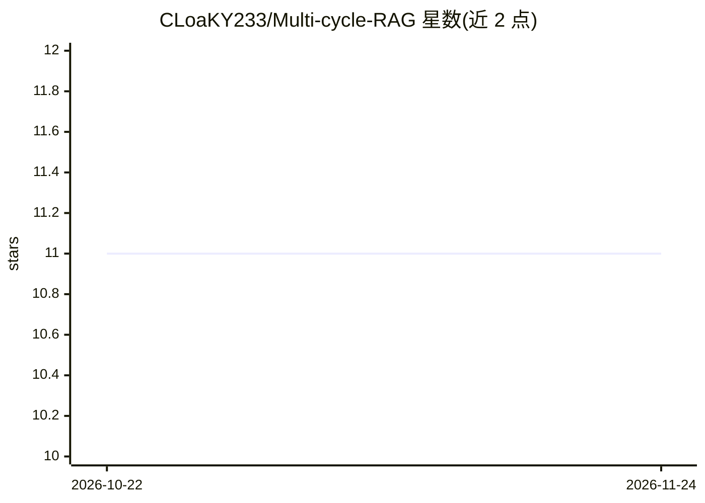

# CLoaKY233/Multi-cycle-RAG

⭐ 11 · Python · MIT · 推送 2026-03-15 · [GitHub](https://github.com/CLoaKY233/Multi-cycle-RAG) · 个人维护

**带自校正循环与网络搜索的多循环 RAG 系统**

基于 Python（uv 管理）的检索增强生成系统，实现 Reflexion 架构：生成、评估、汇总由不同模型分工承担，通过自评估置信度打分、缺口检测与多循环追问产出综合答案，内部四层决策框架决定继续/完成/改写查询/数据不足。检索端将 SurrealDB 向量存储与 Google Custom Search（经 Crawl4AI 抽取网页内容）混合使用，提供三种搜索模式。提供文档摄取与交互式聊天的 CLI 及 Python API，Prompt 以 YAML 模板管理，运行需 SurrealDB 实例与 GitHub Token。

## 筛选速览

| 维度 | 判定 | 备注 |
|---|---|---|
| AI 角色 | `ai-native` | 本体是模型或模型工具 |
| 许可风险 | `permissive` | MIT |
| 部署形态 | `None` |  |
| 模型依赖 | locked-api |  |
| 硬件要求 | — | 无带数字的原话,不猜 |
| 安装摩擦 | `low` | 无编译、无系统依赖或容器化 |
| 成熟度 | — | 结构信号不足 |

## 能力要点

- Reflexion 自校正循环：置信度打分、缺口检测、自动追问（CONTINUE/COMPLETE/REFINE_QUERY/INSUFFICIENT_DATA）
- 多 LLM 分工：生成/评估/汇总各用专属模型，接入 GitHub Models 生态
- SurrealDB 向量检索与 Google Custom Search 混合，支持三种搜索模式
- YAML 模板化 Prompt 管理与运行时指标（循环数、缓存命中率等）

## 适用场景

- 对本地文档做需要多步推理的问答
- 结合实时网络搜索补充知识库缺失信息
- 在 CLI 或自研程序中以 Python API 调用 RAG 流水线

## 场景标签

`RAG` · 领域:知识与检索

## 证据(README 行号)

> L22: A production-ready Retrieval Augmented Generation (RAG) system with advanced self-correction, iterative refinement,
> L27: - **Self-Evaluation System**: Iterative cycles with confidence scoring and dynamic query refinement
> L30: - **Smart Decision Engine**: Four-tier framework (CONTINUE, COMPLETE, REFINE_QUERY, INSUFFICIENT_DATA)

## 星数曲线

2026-10-22 11 → 2026-11-24 11（+0）

---
*卡片 v1 · prompt 1.4 · 生成 2026-11-19 · 置信度 high · 依据 README sha `37a4f5837e06` · [字段定义](../../DATASET.md)*
