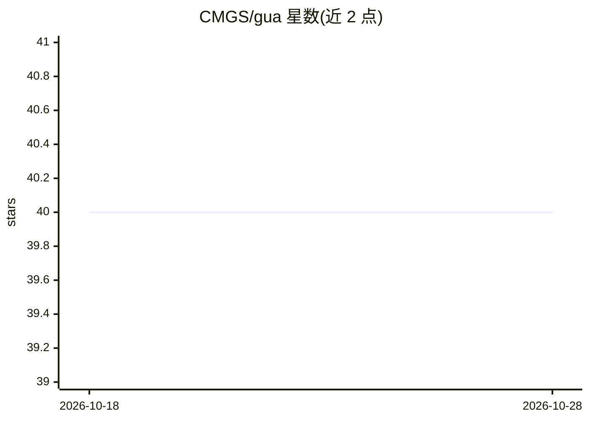

# CMGS/gua

⭐ 40 · Go · MIT · 推送 2026-10-21 · [GitHub](https://github.com/CMGS/gua) · 个人维护 · 中文 README

**多租户 AI agent 服务器：把微信/Telegram 接到 AI agent CLI**

用 Go 编写的多租户 AI agent 服务器，将消息平台（微信、Telegram）与 AI 后端（Claude Code、Codex CLI）对接。每个用户获得隔离会话，复用现有 AI 订阅（如 Claude Max）而无需 API key。Agent / Channel / Runtime 三个维度通过 Go 接口解耦，运行时目前实现 tmux，Claude Code 通过 gua-bridge 以 MCP over Unix socket 通信，Codex 通过 JSON-RPC over FIFO 通信。提供聊天内命令（权限确认、会话管理、yolo 模式）与 CLI 账号/会话管理。需 tmux 与至少一个 agent CLI，从安装脚本或 Go 源码构建安装。

## 筛选速览

| 维度 | 判定 | 备注 |
|---|---|---|
| AI 角色 | `ai-ecosystem` | LLM/agent 周边工具 |
| 许可风险 | `permissive` | MIT |
| 部署形态 | `None` |  |
| 模型依赖 | locked-api |  |
| 硬件要求 | — | 无带数字的原话,不猜 |
| 安装摩擦 | `low` | 无编译、无系统依赖或容器化 |
| 成熟度 | — | 结构信号不足 |

## 能力要点

- Agent / Channel / Runtime 通过 Go 接口解耦，新增实现零改动现有代码
- 多租户隔离会话，复用现有 AI 订阅而非 API key
- 已实现 WeChat / Telegram 渠道与 Claude Code / Codex 后端
- 聊天内权限审批、TUI 菜单转译、语音快捷词（是/好→/yes）

## 适用场景

- 在微信或 Telegram 上多人共享自己的 Claude/ChatGPT 订阅做 AI 对话
- 为团队部署多账号、多会话隔离的 AI bot 服务
- 通过消息平台的内联按钮完成 agent 权限确认

## 场景标签

`聊天机器人` · 领域:对话与助手

## 证据(README 行号)

> L3: Multi-tenant AI agent server that bridges messaging platforms with AI backends through a fully decoupled architectur
> L28: Channel (messaging)     Agent (AI backend)      Runtime (process container)
> L34: All three dimensions are **fully decoupled via Go interfaces**. Adding a new channel, agent, or runtime requires ze

## 星数曲线

2026-10-18 40 → 2026-10-28 40（+0）

---
*卡片 v1 · prompt 1.4 · 生成 2026-10-25 · 置信度 high · 依据 README sha `2f37472be18d` · [字段定义](../../DATASET.md)*
