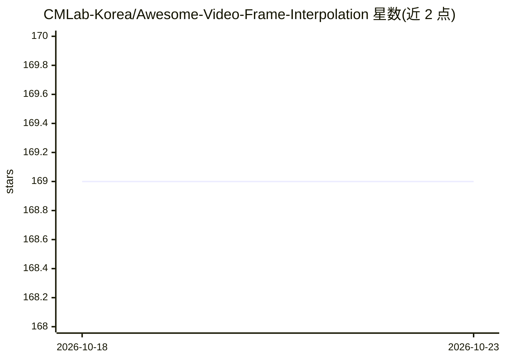

# CMLab-Korea/Awesome-Video-Frame-Interpolation

⭐ 169 · NOASSERTION · 推送 2026-10-15 · [GitHub](https://github.com/CMLab-Korea/Awesome-Video-Frame-Interpolation) · 组织维护

**视频帧插值综述配套论文清单：收录 250+ 篇 VFI 论文**

IEEE TCSVT'26 综述 AceVFI 的配套资源库，按方法类别（运动补偿、核方法、光流、混合、相位、GAN 等）组织超过 250 篇视频帧插值论文，标注发表刊物与年份，收录范围至 2026 年 10 月。综述将 VFI 学习范式分为中心时刻插值（CTFI）与任意时刻插值（ATFI），并覆盖数据集、损失函数、评测指标与应用方向。以列表形式提供，接受社区通过 PR 补充新方法与数据集。

## 筛选速览

| 维度 | 判定 | 备注 |
|---|---|---|
| AI 角色 | `ai-knowledge` | 知识聚合/清单类 |
| 许可风险 | `none` | NOASSERTION |
| 部署形态 | `None` |  |
| 模型依赖 | — | README 未给出锁定关系 |
| 硬件要求 | — | 无带数字的原话,不猜 |
| 安装摩擦 | `low` | 无编译、无系统依赖或容器化 |
| 成熟度 | — | 结构信号不足 |

## 能力要点

- 收录 250+ 篇 VFI 论文，按方法论多级分类组织
- 配套 IEEE TCSVT'26 综述论文（arXiv:2506.01061）
- 条目标注发表刊物与年份，含社区 PR 投稿通道

## 适用场景

- 查找某一方法类别的 VFI 论文与代表性工作
-  newcomer 梳理 VFI 领域方法演进脉络
- 为综述写作检索近年 VFI 论文条目

## 场景标签

`精选清单` `科研工具` · 领域:学习与行业

## 证据(README 行号)

> L12: This repository provides a curated collection of papers, benchmarks, and resources from our survey:
> L21: Video Frame Interpolation (VFI) is a fundamental Low-Level Vision (LLV) task that synthesizes intermediate frames b

## 星数曲线

2026-10-18 169 → 2026-10-23 169（+0）

---
*卡片 v1 · prompt 1.4 · 生成 2026-10-22 · 置信度 high · 依据 README sha `7fa1748877bc` · [字段定义](../../DATASET.md)*
