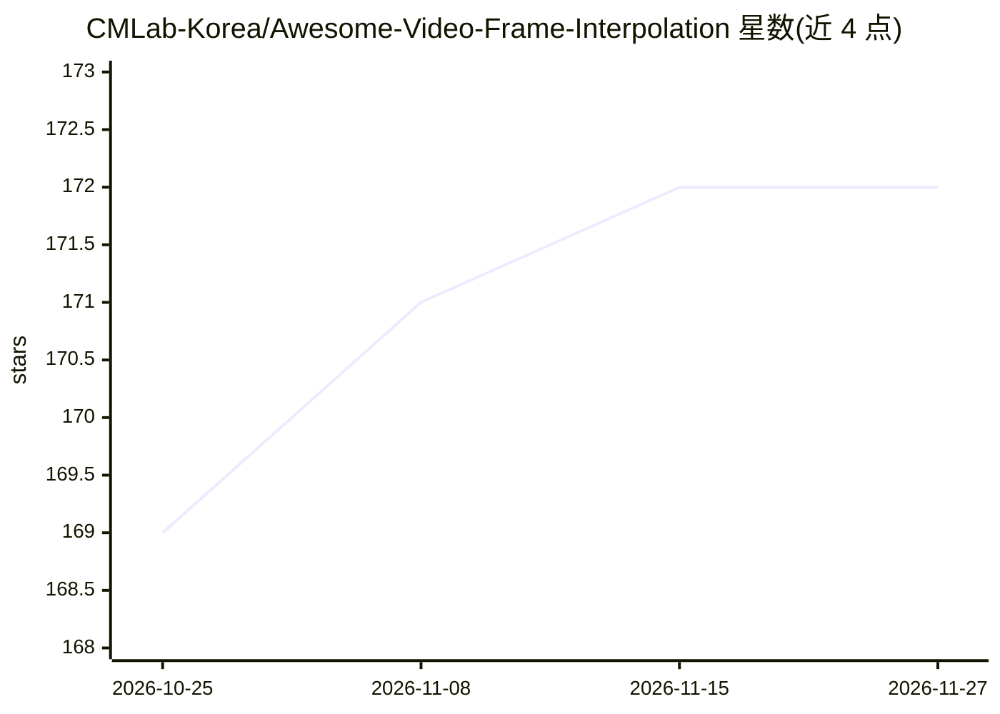

# CMLab-Korea/Awesome-Video-Frame-Interpolation

⭐ 172 · NOASSERTION · 推送 2026-11-11 · [GitHub](https://github.com/CMLab-Korea/Awesome-Video-Frame-Interpolation) · 组织维护

**面向 VFI 研究者的视频帧插值论文综述清单（250+ 篇）**

配合 IEEE TCSVT'26 综述论文《AceVFI》维护的策展清单：按运动补偿、核卷积、光流、相位、GAN、Transformer、Mamba、扩散模型等方法学分类整理 250+ 篇 VFI 论文，覆盖 Center-Time 与 Arbitrary-Time 两类学习范式、数据集、损失函数与评测指标，以及事件相机、卡通、医学图像等应用方向。面向 VFI 领域的新人和研究者提供统一参考，接受社区以 PR 方式提交新方法、数据集与资源。

## 筛选速览

| 维度 | 判定 | 备注 |
|---|---|---|
| AI 角色 | `ai-knowledge` | 知识聚合/清单类 |
| 许可风险 | `none` | NOASSERTION |
| 部署形态 | `None` |  |
| 模型依赖 | — | README 未给出锁定关系 |
| 硬件要求 | — | 无带数字的原话,不猜 |
| 安装摩擦 | `low` | 无编译、无系统依赖或容器化 |
| 成熟度 | — | 结构信号不足 |

## 能力要点

- 覆盖 250+ 篇 VFI 论文的综述配套清单
- 按方法学分类组织（核/流/相位/GAN/Transformer/Mamba/扩散）
- 区分 CTFI 与 ATFI 两类学习范式
- 接受社区 PR 持续收录新方法与数据集

## 适用场景

- 快速了解视频帧插值各技术路线的代表工作
- 查找 VFI 标准数据集与评测指标资料
- 科研入门时按类别系统阅读相关论文

## 场景标签

`精选清单` · 领域:学习与行业

## 证据(README 行号)

> L12: This repository provides a curated collection of papers, benchmarks, and resources from our survey:
> L21: Video Frame Interpolation (VFI) is a fundamental Low-Level Vision (LLV) task that synthesizes intermediate frames b
> L63: 📄 arXiv:2506.01061

## 星数曲线

2026-10-25 169 → 2026-11-27 172（+3）

---
*卡片 v1 · prompt 1.4 · 生成 2026-11-26 · 置信度 high · 依据 README sha `9db82d26902c` · [字段定义](../../DATASET.md)*
