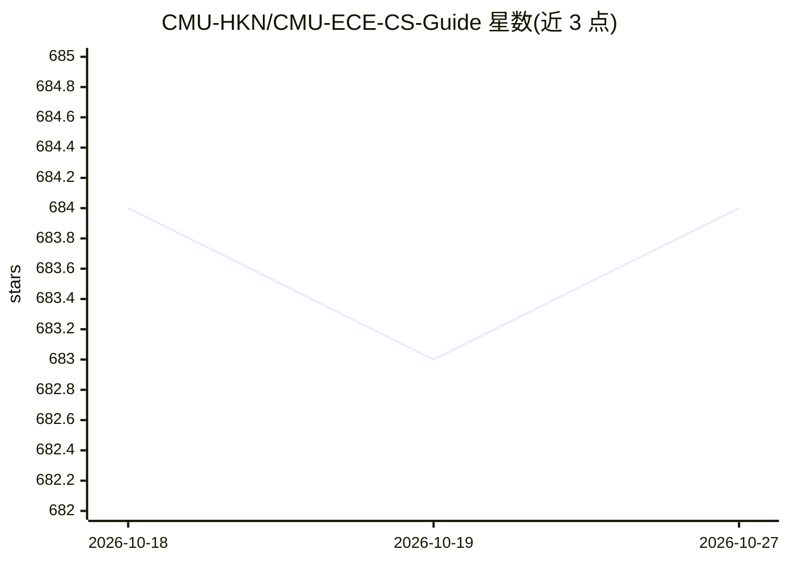

# CMU-HKN/CMU-ECE-CS-Guide

⭐ 684 · TypeScript · 推送 2025-12-30 · [GitHub](https://github.com/CMU-HKN/CMU-ECE-CS-Guide) · [官网](https://cmu-hkn.github.io/CMU-ECE-CS-Guide/) · 组织维护

**面向 CMU ECE/CS 学生的核心课程与选修课指南清单**

由 CMU-HKN（Eta Kappa Nu 学生组织）维护的课程指南仓库：README 按类别列出 ECE 核心、CS 核心、数学/科学要求与选修课程，每条为课程编号与名称，如 15-213 计算机系统导论、10-601 机器学习导论、11-785 深度学习导论等，覆盖从嵌入式、芯片设计到机器学习、机器人等方向的百余门课程。仓库不含安装或运行内容，仅以课程清单形式提供选课参考。

## 筛选速览

| 维度 | 判定 | 备注 |
|---|---|---|
| AI 角色 | `ai-knowledge` | 知识聚合/清单类 |
| 许可风险 | `none` | — |
| 部署形态 | `None` |  |
| 模型依赖 | — | README 未给出锁定关系 |
| 硬件要求 | — | 无带数字的原话,不猜 |
| 安装摩擦 | `low` | 无编译、无系统依赖或容器化 |
| 成熟度 | — | 结构信号不足 |

## 能力要点

- 按 ECE 核心/CS 核心/数学要求/选修四类组织课程条目
- 收录 100 余门课程，覆盖机器学习、计算机视觉、机器人等方向
- 由 CMU-HKN 学生组织维护

## 适用场景

- CMU ECE/CS 学生选课前查看核心与选修课程范围
- 了解 CMU 电气与计算机及计算机科学专业的课程结构

## 场景标签

`精选清单` · 领域:学习与行业

## 证据(README 行号)

> L1: # Guide to ECE and CS at CMU
> L3: Classes at CMU can be hard. This guide is to give some insight on what to

## 星数曲线

2026-10-18 684 → 2026-10-27 684（+0）

---
*卡片 v1 · prompt 1.4 · 生成 2026-10-21 · 置信度 high · 依据 README sha `a5f27126fafc` · [字段定义](../../DATASET.md)*
