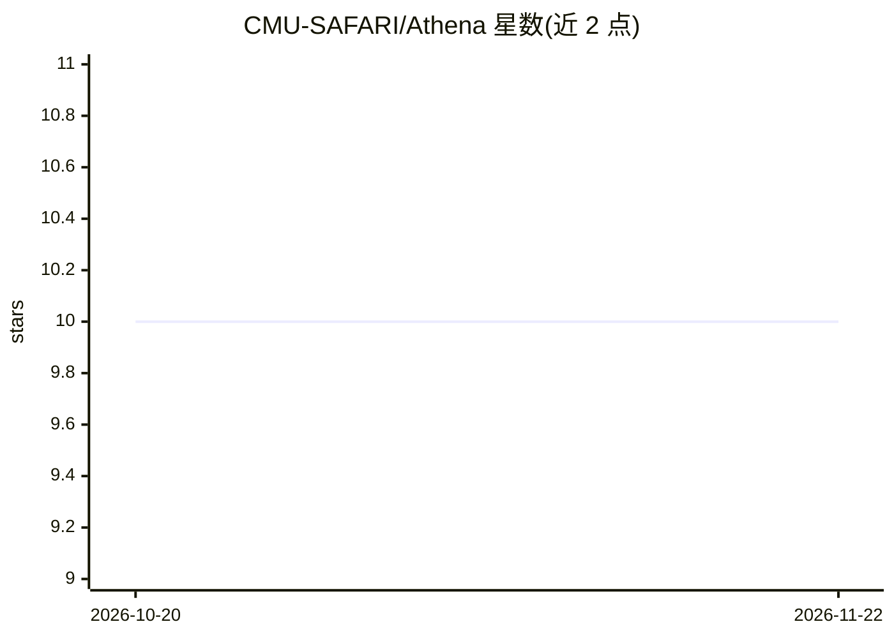

# CMU-SAFARI/Athena

⭐ 10 · C++ · 推送 2026-05-27 · [GitHub](https://github.com/CMU-SAFARI/Athena) · [官网](https://arxiv.org/pdf/2601.17615) · 组织维护

**面向体系结构科研的 RL 预取器协调策略与复现工具**

基于强化学习的策略，在处理器各级缓存上协调片外预测器（OCP）与多个数据预取器：按执行 epoch 观察预取器/OCP 准确率、内存带宽占用等系统特征，执行启用/调整激进度的协调动作，并依据执行周期、LLM miss 延迟等指标变化的奖励在线训练策略。仓库基于 ChampSim 模拟器，提供 make 编译流程、100 条负载 trace 下载校验、athena.py 按论文图表复现实验并聚合 CSV 结果，内含 IPCP/Berti/Pythia/SPP+PPF 等多种预取器与 POPET/HMP/TTP 预测器及 TLP/HPAC/MAB 等对比机制。面向体系结构研究者复现 HPCA 2026 论文结果。

## 筛选速览

| 维度 | 判定 | 备注 |
|---|---|---|
| AI 角色 | `ai-native` | 本体是模型或模型工具 |
| 许可风险 | `permissive` | — |
| 部署形态 | `desktop` | 安装包/桌面程序 |
| 模型依赖 | — | README 未给出锁定关系 |
| 硬件要求 | — | 无带数字的原话,不猜 |
| 安装摩擦 | `medium` | 含编译或系统依赖之一 |
| 成熟度 | — | 结构信号不足 |

## 能力要点

- RL 策略在线协调片外预测器与多级缓存预取器（train_and_take_action 入口）
- 基于 ChampSim 提供 make 编译与一键复现脚本 athena.py（按 FigureID 启动实验）
- 内置多种预取器（IPCP/Berti/Pythia/SPP+PPF/MLOP/SMS）与 OCP（POPET/HMP/TTP）
- 100 条 trace（SPEC/PARSEC/LIGRA/CVP）下载与 sha256 校验流程

## 适用场景

- 复现论文中 Athena 与其他协调机制的加速比实验
- 在 ChampSim 上测试不同预取器与片外预测器组合
- 在自己构建的负载 trace 上评估 RL 协调策略

## 场景标签

`科研工具` `强化学习` · 领域:学习与行业

## 证据(README 行号)

> L25: Athena is a reinforcement learning (RL) based policy to coordinate off-chip predictor (OCP) with multiple data pref
> L222: - `Oogway::train_and_take_action()` is the high-level entry function to Athena that (1) takes a coordination actio

## 星数曲线

2026-10-20 10 → 2026-11-22 10（+0）

---
*卡片 v1 · prompt 1.4 · 生成 2026-11-20 · 置信度 high · 依据 README sha `ce8f807c0cc7` · [字段定义](../../DATASET.md)*
