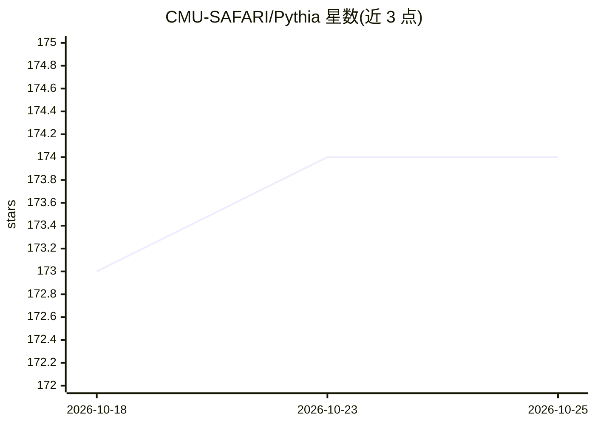

# CMU-SAFARI/Pythia

⭐ 174 · C++ · MIT · 推送 2026-05-27 · [GitHub](https://github.com/CMU-SAFARI/Pythia) · [官网](https://arxiv.org/pdf/2109.12021.pdf) · 组织维护

**强化学习硬件预取框架：在 ChampSim 中生成预取决策**

CMU SAFARI 组发表于 MICRO 2021 的硬件数据预取器研究框架：将硬件预取形式化为在线强化学习任务，依据程序上下文信息与反映预取质量的数值奖励生成预取请求。基于 ChampSim 模拟器实现，集成 12 种先前预取器提案（SPP、Bingo、IPCP 等）作对比；提供 trace 下载/校验、批量实验生成与统计汇总的 Perl 脚本流程，另有 Chisel HDL 实现用于面积与功耗评估。需源码克隆编译，依赖 G++/CMake/Perl 等。

## 筛选速览

| 维度 | 判定 | 备注 |
|---|---|---|
| AI 角色 | `ai-native` | 本体是模型或模型工具 |
| 许可风险 | `permissive` | MIT |
| 部署形态 | `None` |  |
| 模型依赖 | — | README 未给出锁定关系 |
| 硬件要求 | — | 无带数字的原话,不猜 |
| 安装摩擦 | `medium` | 含编译或系统依赖之一 |
| 成熟度 | — | 结构信号不足 |

## 能力要点

- 将硬件预取建模为在线强化学习任务（basic 与 featurewise 两种 RL 引擎）
- 基于 ChampSim，集成 12 种先前预取器提案作对比
- 提供 138 条 trace 的下载、校验与批量实验/统计汇总脚本
- 附带 Chisel HDL 实现用于面积与功耗评估

## 适用场景

- 计算机体系结构研究者复现 MICRO 2021 论文实验
- 对比强化学习预取器与既有预取器提案的性能
- 扩展自定义程序特征（FeatureType）做预取研究

## 场景标签

 · 领域:计算机体系结构/微架构

## 证据(README 行号)

> L38: > Pythia is a hardware-realizable, light-weight data prefetcher that uses reinforcement learning to generate accura
> L40: Pythia formulates hardware prefetching as a reinforcement learning task. For every demand request, Pythia observes 
> L48: Pythia is implemented in ChampSim simulator. We have significantly modified the prefetcher integration pipeline in 

## 星数曲线

2026-10-18 173 → 2026-10-25 174（+1）

---
*卡片 v1 · prompt 1.4 · 生成 2026-10-22 · 置信度 high · 依据 README sha `4b5b02c5a996` · [字段定义](../../DATASET.md)*
