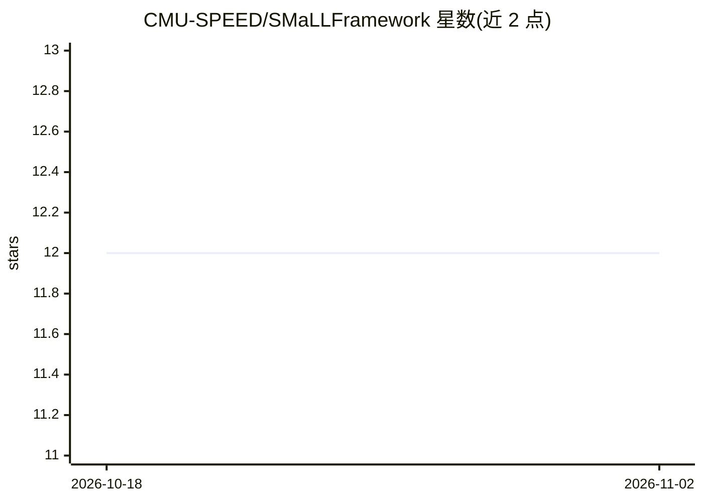

# CMU-SPEED/SMaLLFramework

⭐ 12 · C++ · NOASSERTION · 推送 2026-10-02 · [GitHub](https://github.com/CMU-SPEED/SMaLLFramework) · 组织维护

**为边缘设备快速实例化 DNN 推理库的 C++ 框架**

面向边缘设备的 DNN 推理库快速构建框架：核心机制是各层共享一组循环嵌套内核，层从少量内核实例化而非逐层手写。通过 CMake 的 CMAKE_UARCH 参数指定目标微架构，支持 REF 参考构建、ZEN2、ARM A72/A55/A78/X1 以及 Arduino Nano 33 BLE（仅量化 uint8）。提供卷积、池化、Dense、ReLU/Softmax 等常见层实现。需 C++17 编译器（g++ 9.1.0+）自行编译，有配套论文（ACM TECS）。

## 筛选速览

| 维度 | 判定 | 备注 |
|---|---|---|
| AI 角色 | `ai-ecosystem` | LLM/agent 周边工具 |
| 许可风险 | `none` | NOASSERTION |
| 部署形态 | `None` |  |
| 模型依赖 | — | README 未给出锁定关系 |
| 硬件要求 | — | 无带数字的原话,不猜 |
| 安装摩擦 | `medium` | 含编译或系统依赖之一 |
| 成熟度 | — | 结构信号不足 |

## 能力要点

- 层由少量共享内核实例化，非逐层手写
- CMAKE_UARCH 指定目标微架构（REF/ZEN2/ARM A72/A55/A78/X1/Q-ARM7E）
- 支持 1D/2D 卷积、分组/深度wise 卷积、池化、上采样等层
- 可构建 Arduino Nano 33 BLE 的量化 uint8 子集

## 适用场景

- 为 Raspberry Pi、Snapdragon 等边缘硬件生成 DNN 推理库
- 在 Arduino 级 MCU 上运行量化神经网络
- 研究跨架构内核实例化的 DNN 库构建方法

## 场景标签

`推理引擎` · 领域:训练与推理

## 证据(README 行号)

> L3: SMaLL is a framework for rapidly instantiating DNN based libraries for different architecture. In particular, the ob
> L5: A detailed discussion of the framework can be found here (preprint), and here (ACM Transaction of Embedded System ar

## 星数曲线

2026-10-18 12 → 2026-11-02 12（+0）

---
*卡片 v1 · prompt 1.4 · 生成 2026-11-01 · 置信度 high · 依据 README sha `41d279606994` · [字段定义](../../DATASET.md)*
