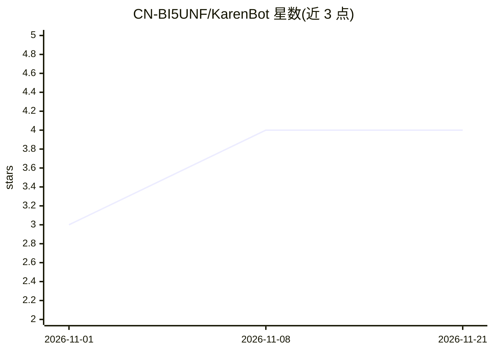

# CN-BI5UNF/KarenBot

⭐ 4 · Python · Apache-2.0 · 推送 2026-11-14 · [GitHub](https://github.com/CN-BI5UNF/KarenBot) · 个人维护 · 中文 README

**人格聊天智能体框架：WebUI + QQ 接入 + 多 LLM Provider**

Python 编写的通用聊天智能体框架， fork 自 Debata_Agent 并以 Apache-2.0 发布。给一个人格 prompt 后通过 WebUI 或 QQ（经 NapCat WebSocket）与用户聊天，核心机制包括：人格系统与动态状态、长期记忆（记忆文件与 RAG 两模式）、多轮工具循环（搜索/天气/定时唤醒/子 Agent）、LLM 可操作的表情包目录、以及默认无网络无特权的受控 Docker 容器执行环境。当前为 1.0.1-alpha.1 重构快照，接口可能调整。

## 筛选速览

| 维度 | 判定 | 备注 |
|---|---|---|
| AI 角色 | `ai-native` | 本体是模型或模型工具 |
| 许可风险 | `permissive` | Apache-2.0 |
| 部署形态 | `library` | 以包/库形式分发 |
| 模型依赖 | locked-api |  |
| 硬件要求 | — | 无带数字的原话,不猜 |
| 安装摩擦 | `low` | 无编译、无系统依赖或容器化 |
| 成熟度 | `idea` | |

## 能力要点

- 多 Provider 预设（OpenAI/Anthropic/DeepSeek/GLM/Qwen/Gemini/OpenRouter）及自定义兼容端点
- QQ/NapCat 接入：私聊/群聊、黑白名单、按群 @ 触发窗口
- 长期记忆文件与 RAG 两种模式，归档不改写原始历史
- LLM 可在受控 Docker 容器中执行命令与读写 /workspace

## 适用场景

- 给 QQ 群/私聊部署一个有固定人格的聊天机器人
- 在 WebUI 中配置人格、记忆和模型并直接对话
- 让智能体在沙箱容器里执行命令并管理文件

## 场景标签

`聊天机器人` `Agent 记忆` `RAG` · 领域:Agent 开发

## 证据(README 行号)

> L14: KarenBot 是一个通用聊天智能体框架。你给它一个人格，它就活成那个人。
> L31: - **WebUI**：FastAPI 后端 + 无构建步骤的静态前端；向导、设置、聊天、记忆、日志、更新；模型配置集中在「模型管理」，侧栏可折叠为纯图标。

## 星数曲线

2026-11-01 3 → 2026-11-21 4（+1）

---
*卡片 v1 · prompt 1.4 · 生成 2026-11-21 · 置信度 mid · 依据 README sha `a468274e2867` · [字段定义](../../DATASET.md)*
