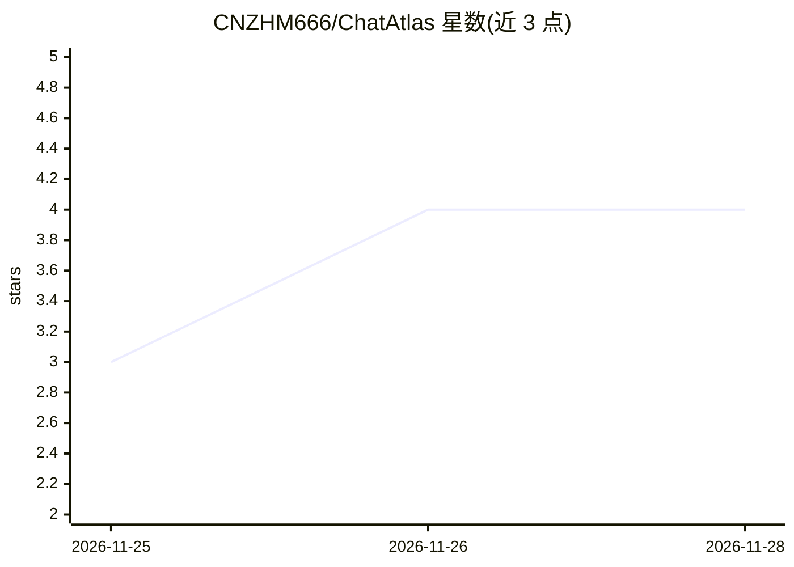

# CNZHM666/ChatAtlas

⭐ 4 · TypeScript · MIT · 推送 2026-11-24 · [GitHub](https://github.com/CNZHM666/ChatAtlas) · [官网](https://github.com/CNZHM666/ChatAtlas/releases/latest) · 个人维护 · 中文 README

**把多平台 AI 对话整理成可溯源交接 wiki 的 Chrome 扩展**

本地优先的 Chrome/Edge 扩展，从 ChatGPT、Claude、Gemini、DeepSeek、豆包、Kimi、通义千问等平台导入对话，分批抽取知识并保留引文与消息 ID，生成带证据跳转的项目 wiki，可导出含引用或原文摘录的 Markdown 供协作者或编码代理使用。阅读、检索、导出无需 API key；wiki 生成、语义搜索、侧栏问答走 BYOK，密钥存于浏览器，数据存于 IndexedDB。Alpha 阶段经 GitHub 分发 ZIP 手动加载，长对话处理耗时且输出质量受模型与素材影响。

## 筛选速览

| 维度 | 判定 | 备注 |
|---|---|---|
| AI 角色 | `ai-enhanced` | 去掉 AI 部分产品仍成立 |
| 许可风险 | `permissive` | MIT |
| 部署形态 | `desktop` | 安装包/桌面程序 |
| 模型依赖 | — | README 未给出锁定关系 |
| 硬件要求 | — | 无带数字的原话,不猜 |
| 安装摩擦 | `low` | 无编译、无系统依赖或容器化 |
| 成熟度 | `idea` | |

## 能力要点

- 多平台对话合并为单一项目 wiki，条目链接到源消息 ID
- Check evidence 面板可跳回原对话定位引文段落
- 本地优先：阅读/检索/导出无需 AI key，BYOK 请求直达所配置提供商
- 导出 Markdown 交接文档，可附引用 ID 或原文摘录

## 适用场景

- 把多个 AI 平台的项目讨论沉淀成可溯源的交接文档
- 团队协作者或编码代理快速接手项目上下文
- 核验 AI 结论是否确有对话原文支撑

## 场景标签

`知识库管理` `语义搜索` · 领域:知识与检索

## 证据(README 行号)

> L13:  A local-first Chrome extension. Connect your own model API to generate a wiki, then export the Markdown you need f
> L16: > **Alpha · Chrome / Edge.** Local reading, keyword search, and export require no AI key. Wiki generation uses your
> L23: - **Local-first, with AI on demand.** Conversations, the ledger, and the wiki are stored in your browser's IndexedD

## 星数曲线

2026-11-25 3 → 2026-11-28 4（+1）

---
*卡片 v1 · prompt 1.4 · 生成 2026-11-24 · 置信度 high · 依据 README sha `acf66bd1b93b` · [字段定义](../../DATASET.md)*
