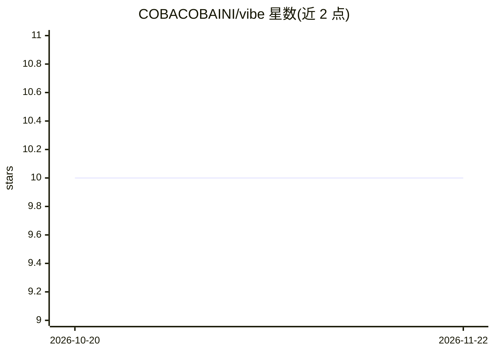

# COBACOBAINI/vibe

⭐ 10 · TypeScript · MIT · 推送 2026-10-13 · [GitHub](https://github.com/COBACOBAINI/vibe) · 个人维护

**本地离线音视频转写桌面应用，数据不出设备**

vibe 是一个跨平台桌面转写应用，使用 Whisper 模型在本机离线转录音频与录音，默认不将数据发送到外部服务；提供 API key 时可选用 OpenAI 在线后端。支持 Windows/macOS/Linux，加载 WAV/MP3/FLAC/Ogg 等格式，输出 TXT/SRT/VTT/JSON，支持语言检测与提示、说话人标签与时间戳。安装走官方 Releases 下载安装包，也可用 Rust 工具链从源码构建。内存与 CPU 占用随模型大小与音频时长变化。

## 筛选速览

| 维度 | 判定 | 备注 |
|---|---|---|
| AI 角色 | `ai-native` | 本体是模型或模型工具 |
| 许可风险 | `permissive` | MIT |
| 部署形态 | `desktop` | 安装包/桌面程序 |
| 模型依赖 | — | README 未给出锁定关系 |
| 硬件要求 | — | 无带数字的原话,不猜 |
| 安装摩擦 | `low` | 无编译、无系统依赖或容器化 |
| 成熟度 | — | 结构信号不足 |

## 能力要点

- Whisper 模型本地离线转写，默认数据不出设备
- 可选 OpenAI API 后端处理复杂音频
- 导出 TXT/SRT/VTT/JSON，含时间戳与字幕格式
- 多语言检测与自定义词表支持

## 适用场景

- 把录音/音频文件离线转成文字稿
- 为视频生成 SRT/VTT 字幕
- 处理隐私敏感的语音内容，不上传云端
- 按模型大小在速度与精度间选择转写方案

## 场景标签

`语音识别` · 领域:感知与多模态

## 证据(README 行号)

> L32: vibe is a cross-platform desktop app designed to help you transcribe audio files and recordings on your own machine
> L52: - Transcription engine options: offline Whisper models, with optional OpenAI integration for higher accuracy on dem

## 星数曲线

2026-10-20 10 → 2026-11-22 10（+0）

---
*卡片 v1 · prompt 1.4 · 生成 2026-11-20 · 置信度 high · 依据 README sha `33a5272e921a` · [字段定义](../../DATASET.md)*
