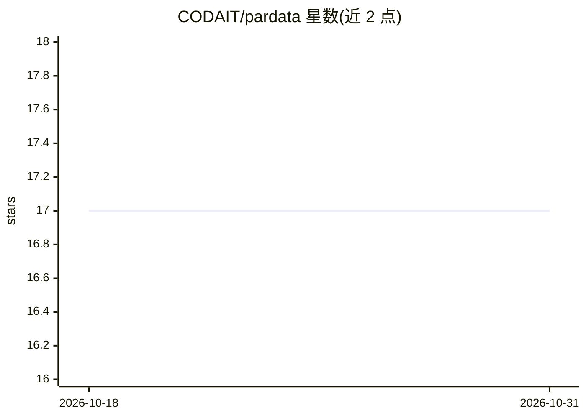

# CODAIT/pardata

⭐ 17 · Python · Apache-2.0 · 推送 2026-10-28 · [GitHub](https://github.com/CODAIT/pardata) · [官网](https://pardata.readthedocs.io/en/latest/) · 组织维护

**供数据科学家与分发者统一加载和共享数据集的 Python API**

由 CODAIT（IBM 开源 AI 组织）维护的 Python 库，为数据消费者与分发者建立数据资产交换标准。数据科学家可通过 list_all_datasets 与 load_dataset 等函数以统一方式发现、下载并加载多版本数据集（如 WikiText-103、Groningen Mean Bank）；数据分发者可按一致、开源的方式向社区共享数据。默认下载数据至 ~/.pardata/data，可用 init 更改数据目录，也支持加载已下载的离线数据（download=False）。仅通过 pip 提供安装途径。

## 筛选速览

| 维度 | 判定 | 备注 |
|---|---|---|
| AI 角色 | `ai-ecosystem` | LLM/agent 周边工具 |
| 许可风险 | `permissive` | Apache-2.0 |
| 部署形态 | `library` | 以包/库形式分发 |
| 模型依赖 | — | README 未给出锁定关系 |
| 硬件要求 | — | 无带数字的原话,不猜 |
| 安装摩擦 | `low` | 无编译、无系统依赖或容器化 |
| 成熟度 | — | 结构信号不足 |

## 能力要点

- 统一的 list_all_datasets/load_dataset API 跨数据集加载
- 自动下载未缓存的数据集并按 版本 目录管理
- 可配置默认数据目录并支持离线加载已下载数据

## 适用场景

- 我不想为每个数据集写不同下载脚本，希望统一加载
- 数据团队想按统一标准把数据集共享给社区
- 把数据集缓存到指定目录后离线复用

## 场景标签

 · 领域:数据科学/数据集工具

## 证据(README 行号)

> L40: ParData (homophone of *partake*) is a Python API that enables data consumers and distributors to easily use and sha
> L43: - a data scientist to have a simpler and more unified way to begin working with a wide range of datasets, and

## 星数曲线

2026-10-18 17 → 2026-10-31 17（+0）

---
*卡片 v1 · prompt 1.4 · 生成 2026-10-30 · 置信度 mid · 依据 README sha `bbcf696c0242` · [字段定义](../../DATASET.md)*
