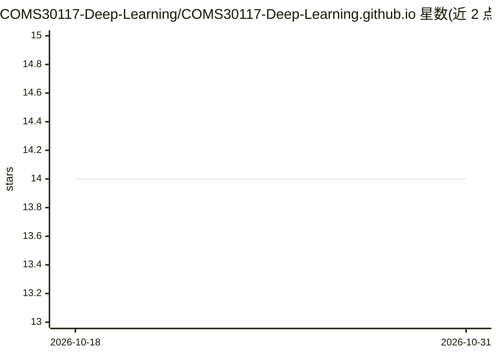

# COMS30117-Deep-Learning/COMS30117-Deep-Learning.github.io

⭐ 14 · HTML · 推送 2026-10-20 · [GitHub](https://github.com/COMS30117-Deep-Learning/COMS30117-Deep-Learning.github.io) · [官网](https://coms30117-deep-learning.github.io/) · 组织维护

**布里斯托大学应用深度学习课程单元网站**

布里斯托大学 COMSM0045 Applied Deep Learning 课程单元的网站仓库，托管于 GitHub Pages，通过 CircleCI 构建部署。README 仅说明网站标题与贡献指引，内容以课程资料为主，属于教学用途网页，非软件项目。

## 筛选速览

| 维度 | 判定 | 备注 |
|---|---|---|
| AI 角色 | `ai-knowledge` | 知识聚合/清单类 |
| 许可风险 | `none` | — |
| 部署形态 | `None` |  |
| 模型依赖 | — | README 未给出锁定关系 |
| 硬件要求 | — | 无带数字的原话,不猜 |
| 安装摩擦 | `low` | 无编译、无系统依赖或容器化 |
| 成熟度 | — | 结构信号不足 |

## 能力要点

- 课程单元 COMSM0045 的公开网站
- 通过 CircleCI 持续构建部署

## 适用场景

- 查看课程单元信息与教学资料

## 场景标签

`教程课程` · 领域:学习与行业

## 证据(README 行号)

> L1: # COMSM0045 Applied Deep Learning Website

## 星数曲线

2026-10-18 14 → 2026-10-31 14（+0）

---
*卡片 v1 · prompt 1.4 · 生成 2026-10-31 · 置信度 low · 依据 README sha `7d97dbb1b152` · [字段定义](../../DATASET.md)*
