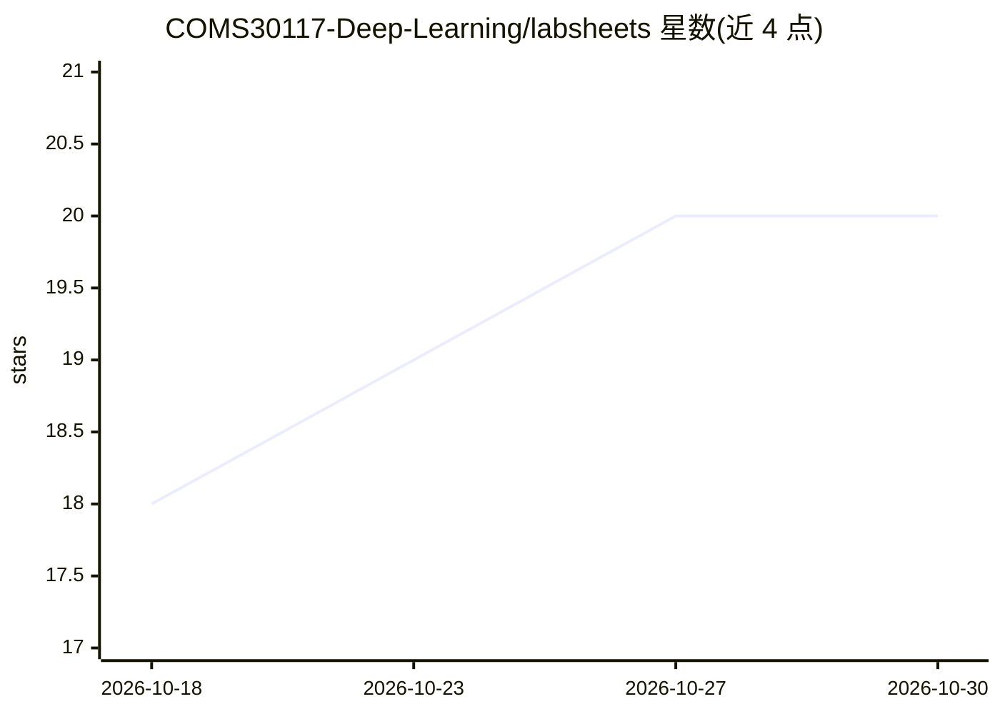

# COMS30117-Deep-Learning/labsheets

⭐ 20 · Jupyter Notebook · 推送 2026-10-06 · [GitHub](https://github.com/COMS30117-Deep-Learning/labsheets) · 组织维护

**布里斯托大学应用深度学习课程的 PyTorch 实验讲义集**

为 Applied Deep Learning 课程（COMS30117）提供的系列实验讲义，覆盖 Python 科学计算生态入门、全连接网络、CNN、DNN 训练技巧、数据增强与 Transformers 共 7 个主题，以 Jupyter notebook 形式发布。课程使用两种计算环境：Colaboratory 用于轻量实验，实验室机器用于 GPU 加速实验；另提供本地安装 Jupyter 与 SSH 连接 BC4 集群的指引。遇到问题建议通过 GitHub issue 反馈。

## 筛选速览

| 维度 | 判定 | 备注 |
|---|---|---|
| AI 角色 | `ai-knowledge` | 知识聚合/清单类 |
| 许可风险 | `none` | — |
| 部署形态 | `None` |  |
| 模型依赖 | — | README 未给出锁定关系 |
| 硬件要求 | — | 无带数字的原话,不猜 |
| 安装摩擦 | `low` | 无编译、无系统依赖或容器化 |
| 成熟度 | — | 结构信号不足 |

## 能力要点

- 7 个递进主题：从 Python 生态到 Transformers
- notebook 形式，可通过 NBViewer 在线查看
- 提供 Colab 与 GPU 实验室机器两种环境指引

## 适用场景

- 按讲义顺序学习 PyTorch 深度学习实践
- 课程学生在 Colab 或实验室机器上完成实验
- 遇到环境问题按 README 指引提交 issue

## 场景标签

`教程课程` · 领域:学习与行业

## 证据(README 行号)

> L3: Labsheets for the Applied Deep Learning course.
> L9: |0|Introduction to Python and the scientific Python ecosystem|
> L10: |1|Your First Fully Connected Network|

## 星数曲线

2026-10-18 18 → 2026-10-30 20（+2）

---
*卡片 v1 · prompt 1.4 · 生成 2026-10-28 · 置信度 high · 依据 README sha `2bf1eda5d123` · [字段定义](../../DATASET.md)*
