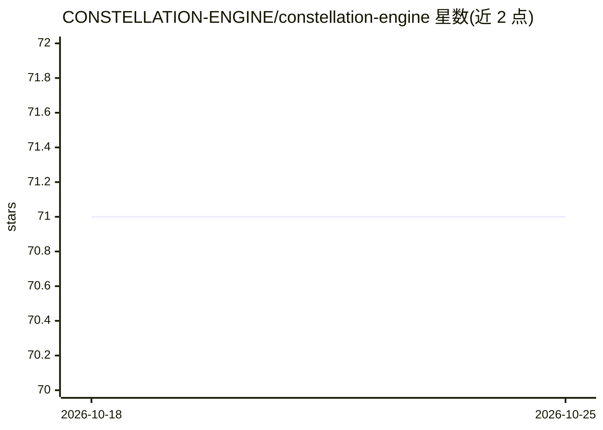

# CONSTELLATION-ENGINE/constellation-engine

⭐ 71 · JavaScript · AGPL-3.0 · 推送 2026-06-27 · [GitHub](https://github.com/CONSTELLATION-ENGINE/constellation-engine) · [官网](https://constellation-engine.com) · 个人维护

**为长周期 AI agent 提供持久记忆拓扑运行时**

面向需要长期记忆的 AI agent 的认知运行时：将记忆组织为带类型节点与加权边的知识图谱（星图），每轮对话以嵌入向量作为激活信号，经扩散（Mímir）、注意力池选层、Narrative IR 编译成结构化上下文交给 LLM；回合后进行 Hebbian 回写、衰减与 Leiden 分区巩固。模型可更换而记忆保留，本地优先，AGPL-3.0 许可，需 Node 20+。

## 筛选速览

| 维度 | 判定 | 备注 |
|---|---|---|
| AI 角色 | `ai-ecosystem` | LLM/agent 周边工具 |
| 许可风险 | `viral` | AGPL-3.0 |
| 部署形态 | `library` | 以包/库形式分发 |
| 模型依赖 | — | README 未给出锁定关系 |
| 硬件要求 | — | 无带数字的原话,不猜 |
| 安装摩擦 | `low` | 无编译、无系统依赖或容器化 |
| 成熟度 | — | 结构信号不足 |

## 能力要点

- 星图持久知识图谱：类型化节点/边 + 三层内容分辨率（L0/L1/L2）+ BGE-M3 嵌入
- Mímir 激活守护进程：Multi-SA 三通道扩散、500ms 心跳、Hebbian 回写、边衰减与 Leiden 分区
- 注意力池按快速/慢速激活、拓扑质量、桥接值等评分选取上下文
- Narrative IR 将激活图材料编译为结构化提示上下文（4 层上下文预算与精度分层）

## 适用场景

- 让长期运行的 agent 跨会话保留身份、偏好与项目知识
- 更换云端/本地模型而不丢失 agent 记忆
- 以激活扩散替代纯 top-k 检索构建 agent 记忆层

## 场景标签

`Agent 记忆` `知识图谱` · 领域:Agent 开发

## 证据(README 行号)

> L5:  Knowledge Topology Runtime for Stateful AI Agents
> L17: Constellation Engine turns memory from a passive retrieval store into an active topology: a living star map of type
> L46: Constellation Engine is an attempt to build that missing layer.

## 星数曲线

2026-10-18 71 → 2026-10-25 71（+0）

---
*卡片 v1 · prompt 1.4 · 生成 2026-10-24 · 置信度 high · 依据 README sha `0958e3ababab` · [字段定义](../../DATASET.md)*
