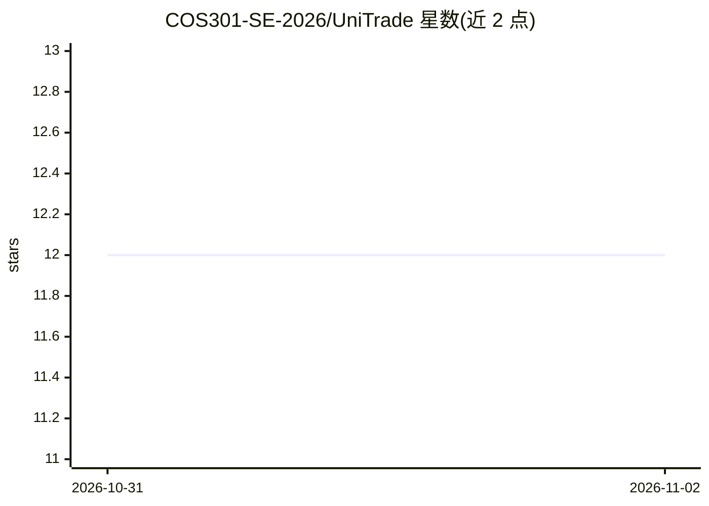

# COS301-SE-2026/UniTrade

⭐ 12 · HTML · 推送 2026-11-01 · [GitHub](https://github.com/COS301-SE-2026/UniTrade) · [官网](https://www.myunitrade.co.za) · 组织维护

**面向南非大学生的二手学术资料 P2P 交易平台**

大学比勒陀利亚 Capstone 团队 DevNexus 开发的 Web 平台：学生经校园邮箱 OTP 与人工注册证明核验后，可挂售、浏览并以托管方式购买同学二手教材。关键机制包括：PayFast 托管支付加一次性交接 PIN、GPS 地理围栏签到、时间表求交的日间校内面谈推荐、跨卖家捆绑折扣的分组背包 Smart Budget，以及由自托管 CLIP 模型、感知哈希与价格异常检测组成的新挂单欺诈风险评分。技术栈为 .NET 10 模块化单体加 React 19 前端与 Python FastAPI CLIP 服务，部署于 Azure Container Apps。

## 筛选速览

| 维度 | 判定 | 备注 |
|---|---|---|
| AI 角色 | `ai-enhanced` | 去掉 AI 部分产品仍成立 |
| 许可风险 | `none` | — |
| 部署形态 | `None` |  |
| 模型依赖 | — | README 未给出锁定关系 |
| 硬件要求 | — | 无带数字的原话,不猜 |
| 安装摩擦 | `medium` | 含编译或系统依赖之一 |
| 成熟度 | — | 结构信号不足 |

## 能力要点

- 自托管 CLIP + dHash + 价格 z-score 的加权集成给每个新挂单打 0-100 欺诈风险分
- PayFast 托管支付与交接 PIN、地理围栏签到支持纠纷处理
- 分组背包动态规划求解跨卖家 Smart Budget 组合
- 时间表反转为空闲区间，双指针扫描线求双方均可的日间面谈时段

## 适用场景

- 以低于新书的价格向同校同学购买二手教材
- 挂牌出售已用过的学术资料并获得托管支付保障
- 按预算与课表安排安全、日间校内面谈交接

## 场景标签

 · 领域:电商/校园市场

## 证据(README 行号)

> L43: |**AI listing screening**|A self-hosted CLIP model, perceptual image hashing and price-anomaly detection score ever
> L83: UniTrade is a **modular monolith**: a single .NET 10 API split into isolated domain modules (Identity, Listings, Re

## 星数曲线

2026-10-31 12 → 2026-11-02 12（+0）

---
*卡片 v1 · prompt 1.4 · 生成 2026-11-01 · 置信度 high · 依据 README sha `2681470d226f` · [字段定义](../../DATASET.md)*
