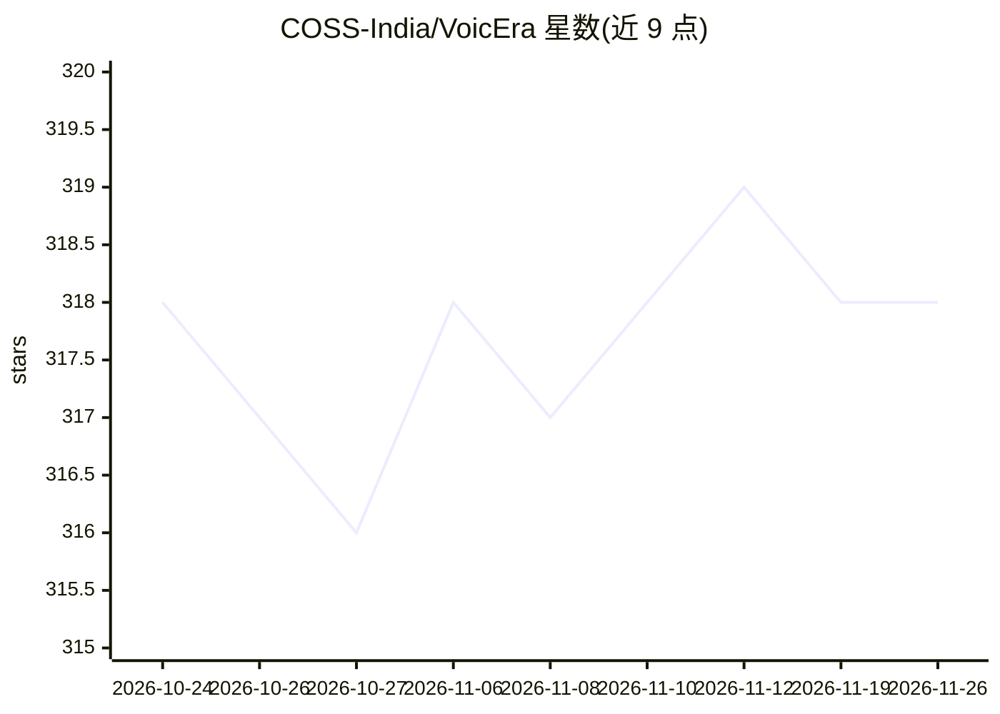

# COSS-India/VoicEra

⭐ 318 · Python · Apache-2.0 · 推送 2026-11-25 · [GitHub](https://github.com/COSS-India/VoicEra) · [官网](https://voicera.mintlify.app/docs/guides) · 组织维护

**自托管语音 AI 平台：组合 STT/TTS/LLM 与电话构建语音代理**

VoicEra 是一个开源的自托管实时语音 AI 基础设施层，面向需要在自有基础设施上部署电话语音代理的运营方，重点支持印度语言与低资源语言。平台将控制面（API、Dashboard、Workers）与实时执行（Runtime）分离，STT、TTS、LLM 与电话服务通过 provider registry 以适配器形式接入，可替换为云 API 或本地模型。README 明确声明平台本身不提供电话账号或 AI 推理，使用者需自备模型与电话服务。

## 筛选速览

| 维度 | 判定 | 备注 |
|---|---|---|
| AI 角色 | `ai-ecosystem` | LLM/agent 周边工具 |
| 许可风险 | `permissive` | Apache-2.0 |
| 部署形态 | `None` |  |
| 模型依赖 | — | README 未给出锁定关系 |
| 硬件要求 | — | 无带数字的原话,不猜 |
| 安装摩擦 | `low` | 无编译、无系统依赖或容器化 |
| 成熟度 | — | 结构信号不足 |

## 能力要点

- STT/TTS/LLM/电话服务商均可通过 provider registry 替换
- 支持通过可选模型服务器以通用网关暴露自托管模型
- 控制面与实时执行分离，含 API、Runtime、Dashboard、Workers、存储组件
- 面向数字公共基础设施设计，Apache 2.0 许可

## 适用场景

- 自托管部署呼入/呼出电话语音代理
- 为印度语及低资源语言搭建语音 AI 服务
- 政府、NGO 等需要数据主权与可独立运营的组织部署语音 AI

## 场景标签

`语音 Agent` · 领域:对话与助手

## 证据(README 行号)

> L22: VoicEra is an open infrastructure layer that puts those choices back with the operator.
> L25: - **Provider neutral** — swap STT, TTS, LLM, and telephony providers without rewriting the platform.
> L83: - **Providers** — interchangeable AI and telephony integrations.

## 星数曲线

2026-10-24 318 → 2026-11-26 318（+0）

---
*卡片 v1 · prompt 1.4 · 生成 2026-11-26 · 置信度 high · 依据 README sha `72b6173bb4b6` · [字段定义](../../DATASET.md)*
