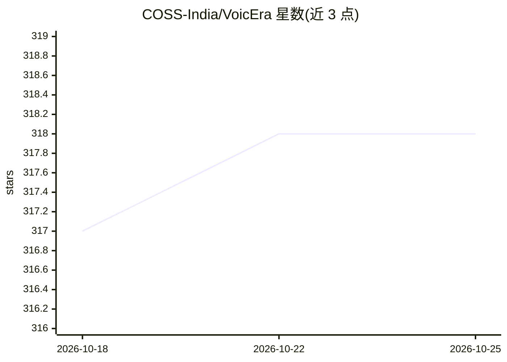

# COSS-India/VoicEra

⭐ 317 · Python · Apache-2.0 · 推送 2026-10-25 · [GitHub](https://github.com/COSS-India/VoicEra) · [官网](https://voicera.mintlify.app/docs/guides) · 组织维护

**自托管实时语音 AI 电话代理平台，可自选模型与运营商**

Apache 2.0 许可的开源语音 AI 基础设施，面向印度语等低资源语言的电话场景：提供 API 控制平面、实时通话 Runtime、操作员 Dashboard、Worker 与自托管存储，STT/TTS/LLM 与电话运营商均通过 provider registry 可替换（现有 Vobiz、Plivo 电话集成，Bhashini/AI4Bharat 等语言集成）。本产品不提供电话账户或 AI 推理，需自带模型与运营商；可选模型服务器暴露自托管模型。通过 Docker 脚本一键启动全栈。

## 筛选速览

| 维度 | 判定 | 备注 |
|---|---|---|
| AI 角色 | `ai-ecosystem` | LLM/agent 周边工具 |
| 许可风险 | `permissive` | Apache-2.0 |
| 部署形态 | `None` |  |
| 模型依赖 | — | README 未给出锁定关系 |
| 硬件要求 | — | 无带数字的原话,不猜 |
| 安装摩擦 | `low` | 无编译、无系统依赖或容器化 |
| 成熟度 | — | 结构信号不足 |

## 能力要点

- 控制平面与实时执行分离的多服务架构（API/Runtime/Dashboard/Worker/Storage）
- STT、TTS、LLM、电话运营商均可通过 provider registry 替换
- 可选模型服务器，经统一网关暴露自托管 STT/TTS/LLM
- 面向印度语与低资源语言，集成 Bhashini、AI4Bharat 等

## 适用场景

- 在自有基础设施上部署电话语音代理，保留通话数据
- 为印度语等低资源语言搭建语音对话服务
- 政府/NGO/公共机构独立运营可复用的语音 AI 系统

## 场景标签

`语音 Agent` · 领域:对话与助手

## 证据(README 行号)

> L3: **Open-source infrastructure for self-hosted, real-time voice AI.**
> L22: VoicEra is an open infrastructure layer that puts those choices back with the operator.
> L81: - **Providers** — interchangeable AI and telephony integrations.

## 星数曲线

2026-10-18 317 → 2026-10-25 318（+1）

---
*卡片 v1 · prompt 1.4 · 生成 2026-10-21 · 置信度 high · 依据 README sha `129df3c894eb` · [字段定义](../../DATASET.md)*
