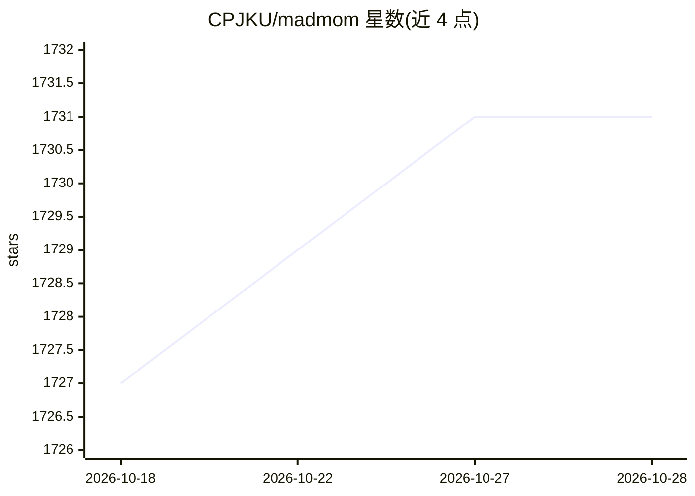

# CPJKU/madmom

⭐ 1,731 · Python · NOASSERTION · 推送 2026-03-20 · [GitHub](https://github.com/CPJKU/madmom) · [官网](https://madmom.readthedocs.io) · 组织维护

**面向音乐信息检索的 Python 音频信号处理库**

Python 编写的音频信号处理库，聚焦音乐信息检索（MIR）任务，由林茨约翰开普勒大学计算感知系与奥地利人工智能研究所内部使用。包含预训练模型（RNN、HMM 等）与可执行程序（如 DBNBeatTracker），支持单文件、批处理与在线实时模式处理音频，输出节拍、onset 等检测结果。经 pip 安装，模型文件以 Git 子模块分发并采用 CC BY-NC-SA 非商业许可，商用需联系作者。

## 筛选速览

| 维度 | 判定 | 备注 |
|---|---|---|
| AI 角色 | `ai-native` | 本体是模型或模型工具 |
| 许可风险 | `none` | NOASSERTION |
| 部署形态 | `library` | 以包/库形式分发 |
| 模型依赖 | — | README 未给出锁定关系 |
| 硬件要求 | — | 无带数字的原话,不猜 |
| 安装摩擦 | `high` | 编译与系统依赖俱全 |
| 成熟度 | — | 结构信号不足 |

## 能力要点

- 提供预训练模型与 /bin 下可执行算法程序（节拍/onset 追踪等）
- 支持 single/batch/online 实时音频处理模式
- 核心依赖 numpy/scipy/cython/mido，附 16 篇论文的参考实现
- 源码 BSD 许可，模型文件 CC BY-NC-SA 非商业许可

## 适用场景

- 对音频文件做节拍、onset 等 MIR 分析
- 在线实时处理现场音频信号
- 作为库集成到音乐信息检索研究项目

## 场景标签

 · 领域:音频/音乐信息检索

## 证据(README 行号)

> L3: Madmom is an audio signal processing library written in Python with a strong
> L16: It includes reference implementations for some music information retrieval
> L178: `/madmom/ml <madmom/ml>`_

## 星数曲线

2026-10-18 1,727 → 2026-10-28 1,731（+4）

---
*卡片 v1 · prompt 1.4 · 生成 2026-10-21 · 置信度 high · 依据 README sha `54b559354b1c` · [字段定义](../../DATASET.md)*
