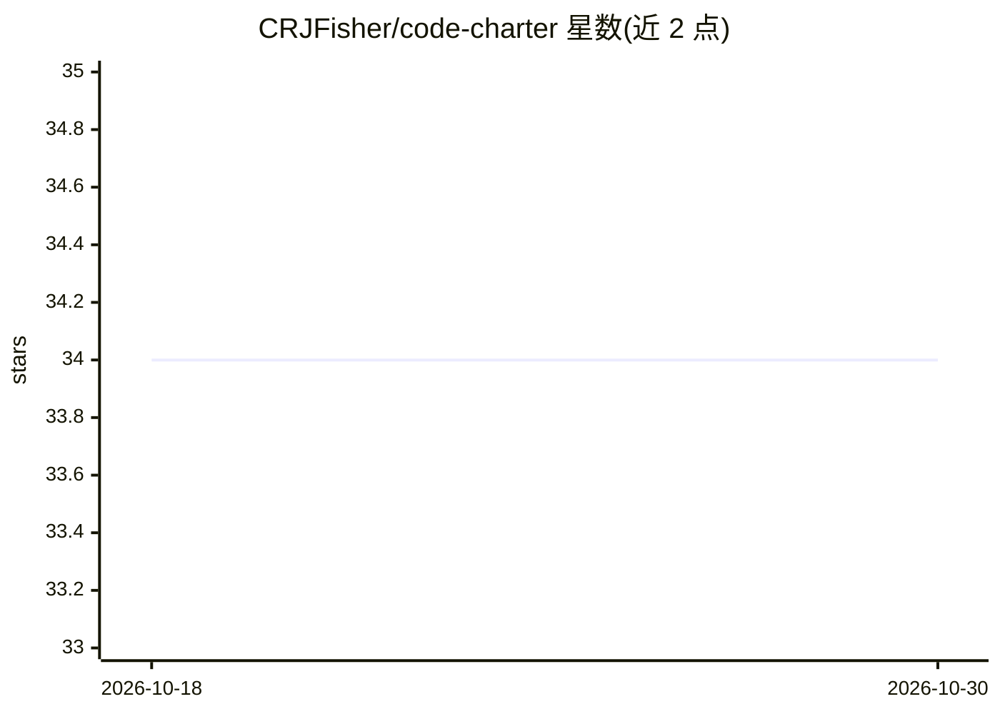

# CRJFisher/code-charter

⭐ 34 · TypeScript · MIT · 推送 2026-07-22 · [GitHub](https://github.com/CRJFisher/code-charter) · 个人维护

**将代码库转为可视化图表的 VS Code 扩展（开发中）**

Code Charter 通过 SCIP 协议索引代码库，解析索引生成调用图，再由本地 Ollama 的 LLM 对函数做摘要并在图表中渲染；支持点击图节点跳转到源码函数。当前语言支持仅 Python（其余语言待 SCIP 解析器可用后支持）。产品形态为 VS Code 扩展，README 标注仍在开发中、下载链接为 TODO；路线图包含与编码 Agent 库的集成。开发流程基于 npm 的 monorepo（vscode/ui/types 三个包）。

## 筛选速览

| 维度 | 判定 | 备注 |
|---|---|---|
| AI 角色 | `ai-enhanced` | 去掉 AI 部分产品仍成立 |
| 许可风险 | `permissive` | MIT |
| 部署形态 | `library` | 以包/库形式分发 |
| 模型依赖 | local-ok | 支持本地模型 |
| 硬件要求 | — | 无带数字的原话,不猜 |
| 安装摩擦 | `low` | 无编译、无系统依赖或容器化 |
| 成熟度 | `idea` | |

## 能力要点

- SCIP 索引代码库并检测调用图
- LLM 生成函数摘要并渲染为图表，支持多轮重摘要
- 点击图节点跳转到对应函数源码
- 本地运行依赖 Ollama

## 适用场景

- 快速理解陌生代码库的结构与业务逻辑
- 在高低抽象层级之间导航浏览代码
- 上手他人项目时缩短学习曲线

## 场景标签

 · 领域:开发者工具/代码理解

## 证据(README 行号)

> L5: Code Charter is a tool designed to enhance the developer experience by transforming complex code into diagrams that 
> L61: 3. Summarise all the individual functions in the call graphs by via LLM, focusing on business logic.

## 星数曲线

2026-10-18 34 → 2026-10-30 34（+0）

---
*卡片 v1 · prompt 1.4 · 生成 2026-10-25 · 置信度 high · 依据 README sha `f8afea9439c9` · [字段定义](../../DATASET.md)*
