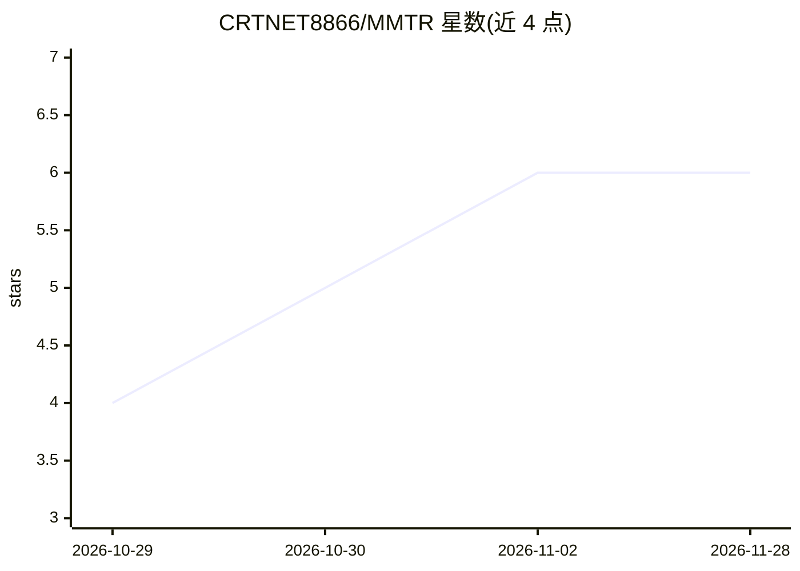

# CRTNET8866/MMTR

⭐ 6 · TypeScript · MIT · 推送 2026-11-04 · [GitHub](https://github.com/CRTNET8866/MMTR) · 个人维护 · 中文 README

**给 agent 用的仿人脑记忆层：带遗忘曲线与联想图**

一个可嵌入 agent/应用的记忆库，零依赖，Node ≥ 22.5，基于内置 node:sqlite 的单文件数据库。经历按 fact/gist/affect 三通道衰减，记忆间以四类边组成联想图，关系状态用六维向量表示并在会话结束结算，承诺类前瞻记忆按到期时间浮现，另有不衰减的常驻块与三道防检索自增强闸门。提供 CLI、HTTP 服务接口与 DSH 插件（六个 agent 工具）；LLM 抽取可选，留空时用内置纯规则启发式，失败自动回退。README 声明未发布到 npm，需源码方式运行，且单机 SQLite 不面向多写并发。

## 筛选速览

| 维度 | 判定 | 备注 |
|---|---|---|
| AI 角色 | `ai-ecosystem` | LLM/agent 周边工具 |
| 许可风险 | `permissive` | MIT |
| 部署形态 | `None` |  |
| 模型依赖 | — | README 未给出锁定关系 |
| 硬件要求 | — | 无带数字的原话,不猜 |
| 安装摩擦 | `low` | 无编译、无系统依赖或容器化 |
| 成熟度 | — | 结构信号不足 |

## 能力要点

- fact/gist/affect 三通道差异化衰减与 L0–L3 层级压缩
- entity/temporal/same_anchor/same_theme 四类联想边检索
- 前瞻记忆：约定到期自动浮现，过期/兑现分别结算关系代价
- 提供 HTTP 接口与 DSH 插件（六个 agent 工具）

## 适用场景

- 为长期陪伴型 agent 添加会遗忘、会联想的记忆层
- 让 agent 跟踪并兑现承诺、约定类事项
- 以 HTTP 服务形式给其他进程提供记忆读写

## 场景标签

`Agent 记忆` · 领域:Agent 开发

## 证据(README 行号)

> L15: 零依赖，Node ≥ 22.5（用内置 `node:sqlite`），单文件数据库，可以被任意 agent / 应用嵌进去。
> L172: `llm` 留空时使用内置启发式（纯规则，不联网）；填 `provider: "deepseek"` 等则启用模型抽取与压缩，失败自动回退启发式。
> L192: MMTR 自带一个 DSH 插件，把同一套核心包成六个 agent 工具。

## 星数曲线

2026-10-29 4 → 2026-11-28 6（+2）

---
*卡片 v1 · prompt 1.4 · 生成 2026-11-20 · 置信度 high · 依据 README sha `1bd57d9f0e65` · [字段定义](../../DATASET.md)*
