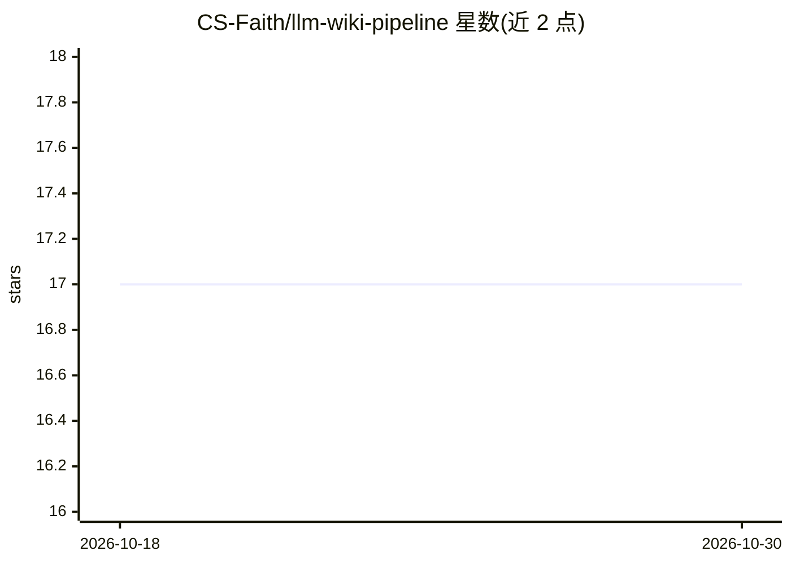

# CS-Faith/llm-wiki-pipeline

⭐ 17 · MIT · 推送 2026-07-09 · [GitHub](https://github.com/CS-Faith/llm-wiki-pipeline) · 个人维护 · 中文 README

**把杂乱原始文件炼成 Obsidian 知识图谱的端到端流水线**

LLM Wiki Pipeline 是一条端到端知识库构建流水线：输入 PDF/MD/网页等原始文件，经五阶段处理（五轮递进查重清理、格式统一、覆盖概览、多 Agent 圆桌深度知识融合、Obsidian 增强输出），产出带 Wikilinks 的 Obsidian 知识图谱，并支持持续增量维护。目标是 70% 密度（设计决策因果、数值参数、接口契约、替代方案对比）。采用深度文章理解层 + 原始文档参考层的双层结构。面向希望将大量原始资料转为结构化知识库的个人知识管理用户。README 未给出具体安装命令。

## 筛选速览

| 维度 | 判定 | 备注 |
|---|---|---|
| AI 角色 | `ai-native` | 本体是模型或模型工具 |
| 许可风险 | `permissive` | MIT |
| 部署形态 | `None` |  |
| 模型依赖 | — | README 未给出锁定关系 |
| 硬件要求 | — | 无带数字的原话,不猜 |
| 安装摩擦 | `low` | 无编译、无系统依赖或容器化 |
| 成熟度 | — | 结构信号不足 |

## 能力要点

- 五阶段流水线：查重清理→格式统一→概览→多 Agent 融合→Obsidian 输出
- 五轮递进查重（MD5→版本链→归一化→压缩包→目录重组）
- 4 Agent 圆桌讨论生成 2-3 万字深度文章
- 双层结构与增量更新（仅处理变化部分）

## 适用场景

- 把几十 GB 的 PDF/MD/网页资料整理成 Obsidian 知识图谱
- 让历史文档参与多视角讨论生成深度文章
- 知识库建成后自动检测变更做增量维护

## 场景标签

`知识图谱` `知识库管理` · 领域:知识与检索

## 证据(README 行号)

> L3: > 你有文件堆，它造知识网：一条流水线，把杂乱档案炼成结构化的知识图谱。
> L22: |多文档圆桌讨论|❌|✅（4 Agent 讨论）|
> L62: - Phase 3B: Deep knowledge via multi-agent roundtable

## 星数曲线

2026-10-18 17 → 2026-10-30 17（+0）

---
*卡片 v1 · prompt 1.4 · 生成 2026-10-30 · 置信度 mid · 依据 README sha `9cf97dec2132` · [字段定义](../../DATASET.md)*
