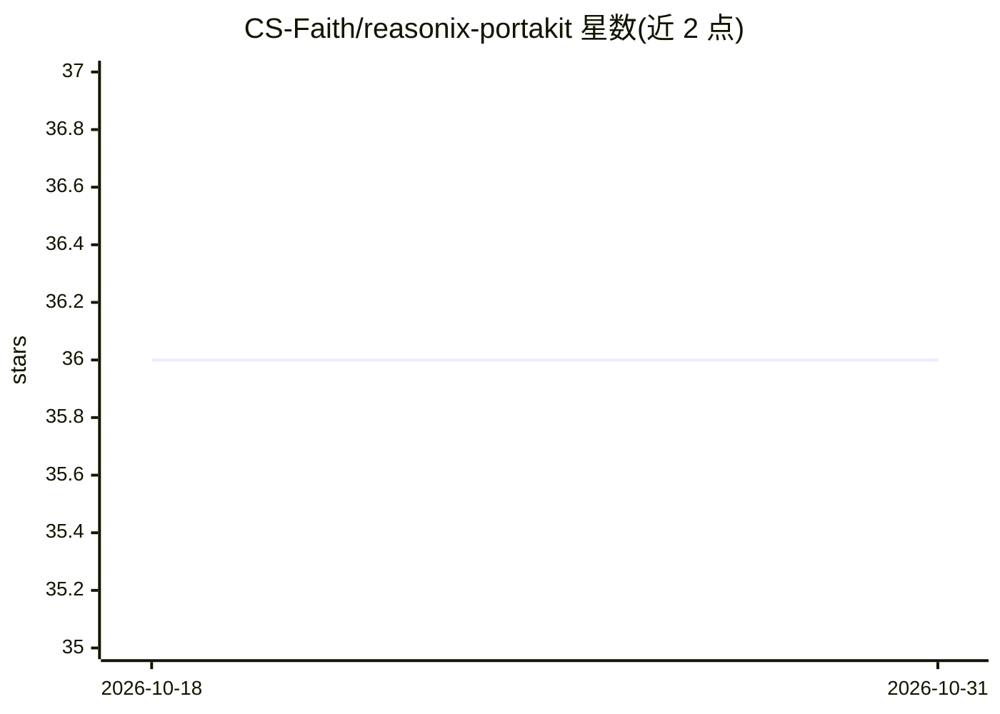

# CS-Faith/reasonix-portakit

⭐ 36 · PowerShell · MIT · 推送 2026-07-16 · [GitHub](https://github.com/CS-Faith/reasonix-portakit) · [官网](https://github.com/CS-Faith/reasonix-portakit) · 个人维护 · 中文 README

**让 Reasonix AI 助手装进 U 盘跨电脑即插即用的便携工具箱**

面向 Reasonix（AI 编码助手）用户的 Windows 便携化工具箱，解决 Reasonix 按路径哈希命名项目导致换电脑后记忆、会话历史、MCP 配置失效的问题。提供两个版本：0.5X 用 HOME/USERPROFILE 环境变量重定向（bat+ps1+js），1.X 用 NTFS Junction（mklink /J）加自动配置修补与数据合并。双击启动、零配置，支持增量非破坏式数据合并与从便携 installers/ 目录惰性安装依赖；另与 Migration Assistant 配套实现 0.5X→1.X 迁移。MIT 许可。

## 筛选速览

| 维度 | 判定 | 备注 |
|---|---|---|
| AI 角色 | `ai-ecosystem` | LLM/agent 周边工具 |
| 许可风险 | `permissive` | MIT |
| 部署形态 | `None` |  |
| 模型依赖 | — | README 未给出锁定关系 |
| 硬件要求 | — | 无带数字的原话,不猜 |
| 安装摩擦 | `low` | 无编译、无系统依赖或容器化 |
| 成熟度 | — | 结构信号不足 |

## 能力要点

- 0.5X 用 HOME/USERPROFILE 重定向，1.X 用 NTFS Junction 实现便携
- 零配置：自动检测当前路径，任意盘符可用
- 增量非破坏式数据合并与自动配置修补
- 从便携 installers/ 目录惰性安装依赖

## 适用场景

- 把 Reasonix 装进 U 盘或同步盘，换电脑继续用同一套会话与记忆
- 解决 Reasonix 项目按路径哈希命名导致换机后记忆和历史找不到的问题
- 配合 migration-assistant 从 0.53 升级到 1.X 且保留数据

## 场景标签

 · 领域:开发工具/AI 助手配套

## 证据(README 行号)

> L3: 把 Reasonix 装进口袋。U盘一插，记忆和工具全在——换电脑零配置。
> L75: Your AI coding assistant shouldn't be stuck on one machine. PortaKit makes Reasonix truly portable — USB drive, syn

## 星数曲线

2026-10-18 36 → 2026-10-31 36（+0）

---
*卡片 v1 · prompt 1.4 · 生成 2026-10-25 · 置信度 high · 依据 README sha `f60ebf646367` · [字段定义](../../DATASET.md)*
