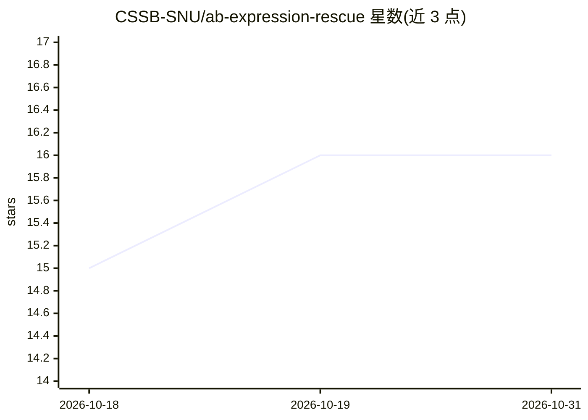

# CSSB-SNU/ab-expression-rescue

⭐ 16 · Jupyter Notebook · NOASSERTION · 推送 2026-05-26 · [GitHub](https://github.com/CSSB-SNU/ab-expression-rescue) · 组织维护

**提出 CDR 单点突变以挽救抗体表达且不破坏抗原结合**

基于 ProteinMPNN 单氨基酸条件 logits 的抗体表达挽救流程：对输入的抗体–抗原复合物分别打分结合态（bound）与去除抗原链的非结合态（unbound），Δ=logit_bound−logit_unbound 大的位点被标记为关键结合残差并排除，其余按 WT 非结合态 logits 升序排序，取 top-K（默认 3）提出替换氨基酸，输出至 rescue_ranking.csv。以 Jupyter notebook 提供，支持本地 GPU 与 Colab 两种运行方式，模型权重随仓库附带。限制：需高质量输入结构，ProteinMPNN 打分含随机性，一次只处理一个复合物，不支持多模型 PDB。

## 筛选速览

| 维度 | 判定 | 备注 |
|---|---|---|
| AI 角色 | `ai-native` | 本体是模型或模型工具 |
| 许可风险 | `none` | NOASSERTION |
| 部署形态 | `library` | 以包/库形式分发 |
| 模型依赖 | — | README 未给出锁定关系 |
| 硬件要求 | — | 无带数字的原话,不猜 |
| 安装摩擦 | `medium` | 含编译或系统依赖之一 |
| 成熟度 | — | 结构信号不足 |

## 能力要点

- bound/unbound 双态 ProteinMPNN 打分区分结合残差与表达挽救候选
- 三阶段自动选择：打分→保护关键结合位点→排序取 top-K 提出突变
- 输出 rescue_ranking.csv、热图、logit 着色 PDB 与内联 3D 视图
- 模型权重随仓库附带，无需单独下载

## 适用场景

- 为表达不佳的抗体设计候选挽救突变
- 识别应保留的关键抗原结合残差
- 在实验前用结构数据筛选 CDR 单点突变方案

## 场景标签

 · 领域:计算生物学/抗体工程

## 证据(README 行号)

> L3: ProteinMPNN-based analysis to propose CDR single-point mutations that may rescue antibody expression without disrupt
> L16: This pipeline uses ProteinMPNN's single-AA conditional logits as a proxy for residue preference. For each input com
> L35: 1. **Score both states.** ProteinMPNN single-AA scoring on the input complex (bound) and on the same coordinates wi

## 星数曲线

2026-10-18 15 → 2026-10-31 16（+1）

---
*卡片 v1 · prompt 1.4 · 生成 2026-10-30 · 置信度 high · 依据 README sha `45e42edffff3` · [字段定义](../../DATASET.md)*
