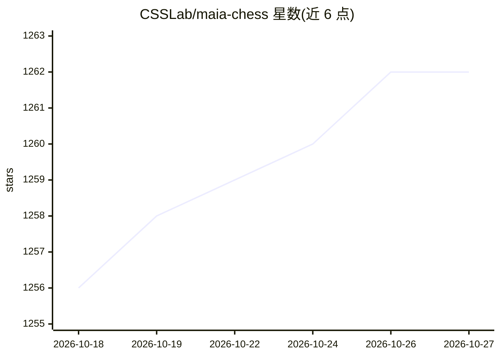

# CSSLab/maia-chess

⭐ 1,262 · Python · GPL-3.0 · 推送 2026-05-24 · [GitHub](https://github.com/CSSLab/maia-chess) · [官网](https://maiachess.com) · 组织维护

**模仿人类棋风的神经网络国际象棋引擎（1100-1900 ELO）**

多伦多大学等团队的研究项目：基于数百万人类对局训练的 9 个棋力分级模型（ELO 1100-1900），以 Leela Chess 神经网络权重形式发布，需配合 lc0 加载并设 nodes 1 禁用搜索。仓库含从 PGN 构建训练数据、复现论文结果及训练失误（blunder）预测模型的代码。模型在 Lichess 上提供对弈 bot。注意模型走平均着法，实际棋力略高于训练目标分。

## 筛选速览

| 维度 | 判定 | 备注 |
|---|---|---|
| AI 角色 | `ai-native` | 本体是模型或模型工具 |
| 许可风险 | `viral` | GPL-3.0 |
| 部署形态 | `None` |  |
| 模型依赖 | — | README 未给出锁定关系 |
| 硬件要求 | — | 无带数字的原话,不猜 |
| 安装摩擦 | `low` | 无编译、无系统依赖或容器化 |
| 成熟度 | — | 结构信号不足 |

## 能力要点

- 9 个按 ELO 1100-1900 分级的人类棋风模型（Leela 权重）
- 提供 LeelaEngine 类在 Python 中调用模型
- 包含从 Lichess PGN 复现训练与 blunder 预测模型的完整代码
- Lichess 上可对弈的 bot（maia1/maia5/maia9）

## 适用场景

- 通过 lc0 与模仿特定棋力水平的人类棋手对弈
- 研究人机对齐与人类行为建模
- 复现论文或用自有 PGN 训练自定义 Maia 模型

## 场景标签

 · 领域:计算社会科学/棋类 AI

## 证据(README 行号)

> L16: A collection of chess engines that play like humans, from ELO 1100 to 1900.
> L20: In this repo is our 9 final maia models saved as Leela Chess neural networks, and the code to create more and repro

## 星数曲线

2026-10-18 1,256 → 2026-10-27 1,262（+6）

---
*卡片 v1 · prompt 1.4 · 生成 2026-10-21 · 置信度 high · 依据 README sha `f6253e9113c1` · [字段定义](../../DATASET.md)*
