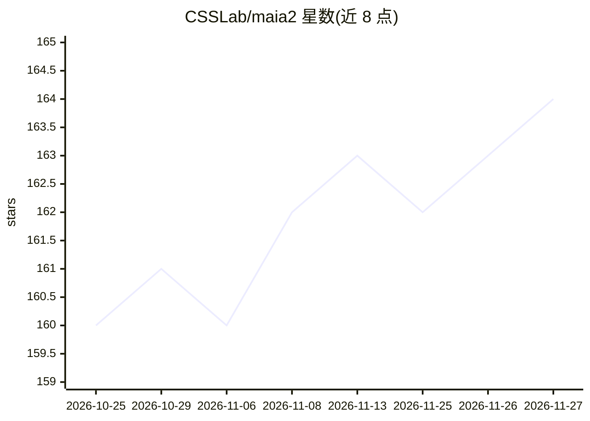

# CSSLab/maia2

⭐ 164 · Python · MIT · 推送 2026-11-25 · [GitHub](https://github.com/CSSLab/maia2) · [官网](https://www.maiachess.com/) · 组织维护

**跨 Elo 等级的类人国际象棋走子预测模型实现**

Maia-2 是多伦多大学 CSSLab 发布的统一技能感知国际象棋模型，依据棋盘局面与双方 Elo 等级预测人类走子与对局结果，覆盖 Rapid 与 Blitz 两种时间制。以 Python 包形式提供，支持从预训练权重推理（批量与逐局面两种模式），并开放在 Lichess 月度对局数据上的完整训练与断点恢复流程；另附可解释性工具仓库，可提取中间激活并训练 172 个棋类概念的 Elo 条件探针。推荐新项目改用 Maia-3。

## 筛选速览

| 维度 | 判定 | 备注 |
|---|---|---|
| AI 角色 | `ai-native` | 本体是模型或模型工具 |
| 许可风险 | `permissive` | MIT |
| 部署形态 | `library` | 以包/库形式分发 |
| 模型依赖 | — | README 未给出锁定关系 |
| 硬件要求 | — | 无带数字的原话,不猜 |
| 安装摩擦 | `medium` | 含编译或系统依赖之一 |
| 成熟度 | — | 结构信号不足 |

## 能力要点

- 按局面与双方 Elo 预测人类走子与期望得分
- 提供 Rapid 与 Blitz 预训练权重，device 支持 CUDA/MPS/CPU
- 开放完整训练管线：Lichess 数据下载脚本、Rapid/Blitz 训练配置与断点恢复
- 附可解释性仓库：172 个棋类概念的 Elo 条件探针

## 适用场景

- 研究不同棋力等级的人类走子模式
- 训练自己的 Maia-2 模型并复现论文流程
- 分析模型内部表示与棋类概念的关系

## 场景标签

 · 领域:机器学习/博弈与人类行为建模

## 证据(README 行号)

> L14: Maia-2 is a unified, skill-aware chess model for predicting human moves and
> L15: outcomes across Elo levels. This repository is the official implementation of
> L16: the NeurIPS 2024 paper

## 星数曲线

2026-10-25 160 → 2026-11-27 164（+4）

---
*卡片 v1 · prompt 1.4 · 生成 2026-11-27 · 置信度 high · 依据 README sha `fbcb690d9151` · [字段定义](../../DATASET.md)*
