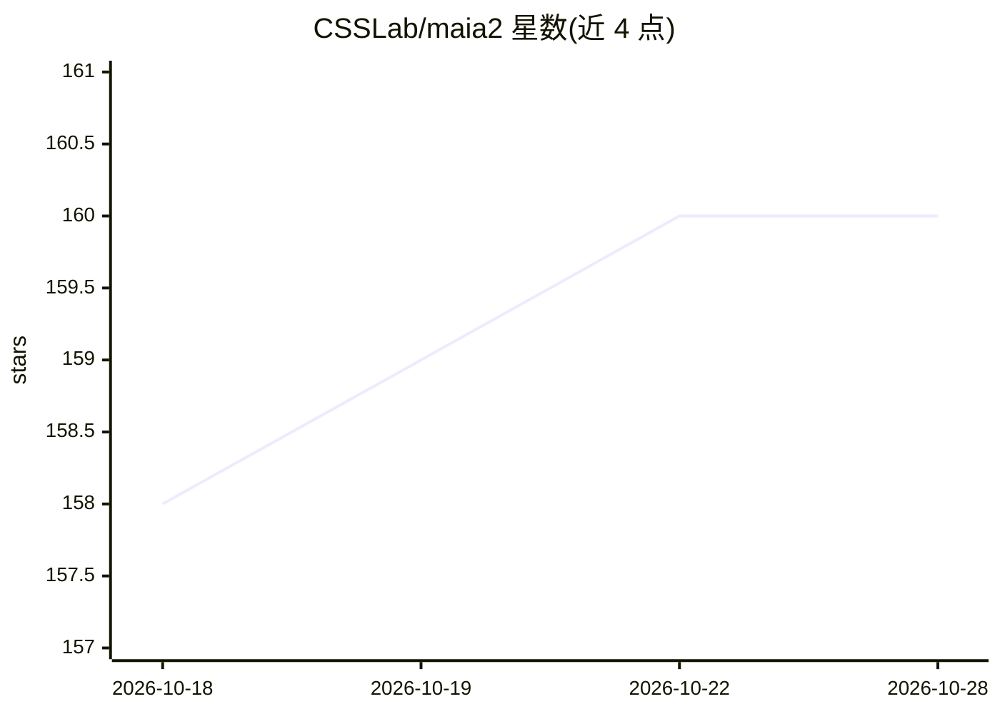

# CSSLab/maia2

⭐ 161 · Python · MIT · 推送 2026-07-22 · [GitHub](https://github.com/CSSLab/maia2) · [官网](https://www.maiachess.com/) · 组织维护

**预测人类棋步与对局结果的技能感知国际象棋模型官方实现**

多伦多大学 CSSLab 发表的 NeurIPS 2024 论文 Maia-2 的官方实现：一个跨 Elo 等级统一预测人类棋步与对局结果的技能感知模型。支持 Python 3.10–3.12，可在 CUDA、Apple MPS 或 CPU 上运行；提供 PyPI 安装、批量与逐局面推理 API，以及基于 Lichess 标准 PGN 数据库（.pgn.zst 归档）的训练流程，含 Rapid/Blitz 预设配置、检查点恢复与数据溯源记录。README 提示新项目建议使用 Maia-3。训练默认配置覆盖 2018-05 至 2023-11 数据、三个 epoch、batch size 8192。

## 筛选速览

| 维度 | 判定 | 备注 |
|---|---|---|
| AI 角色 | `ai-native` | 本体是模型或模型工具 |
| 许可风险 | `permissive` | MIT |
| 部署形态 | `library` | 以包/库形式分发 |
| 模型依赖 | — | README 未给出锁定关系 |
| 硬件要求 | — | 无带数字的原话,不猜 |
| 安装摩擦 | `medium` | 含编译或系统依赖之一 |
| 成熟度 | — | 结构信号不足 |

## 能力要点

- 跨 Elo 等级预测人类棋步与对局结果（Rapid/Blitz 预训练模型）
- 支持 CUDA / Apple MPS / CPU，device auto 选择
- 基于 Lichess 数据库的训练流程，含数据过滤规则与检查点恢复
- 配套可解释性仓库：172 个棋类概念的 Elo 条件探针

## 适用场景

- 加载预训练模型预测特定等级人类棋手会走的棋步
- 在自己的对局数据上复现或继续训练模型
- 研究人机对齐与按技能水平建模的棋类行为

## 场景标签

`模型训练` · 领域:训练与推理

## 证据(README 行号)

> L14: Maia-2 is a unified, skill-aware chess model for predicting human moves and
> L16: the NeurIPS 2024 paper
> L22: Maia-2 supports Python 3.10–3.12 and runs on CUDA, Apple MPS, or CPU.

## 星数曲线

2026-10-18 158 → 2026-10-28 160（+2）

---
*卡片 v1 · prompt 1.4 · 生成 2026-10-22 · 置信度 high · 依据 README sha `b28955d45431` · [字段定义](../../DATASET.md)*
