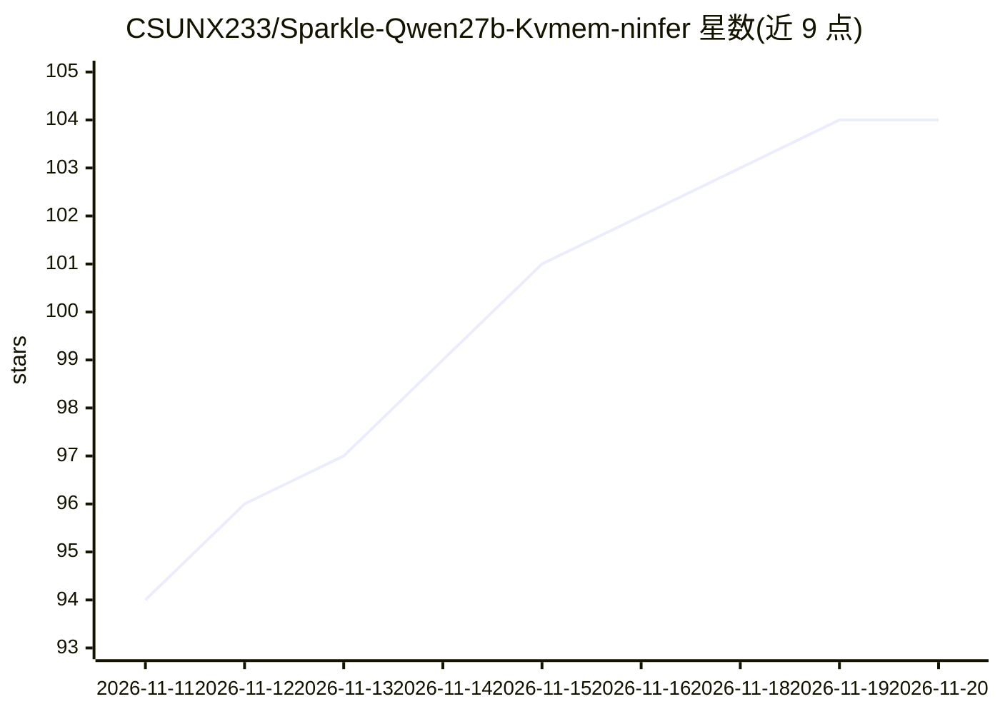

# CSUNX233/Sparkle-Qwen27b-Kvmem-ninfer

⭐ 104 · C++ · Apache-2.0 · 推送 2026-11-19 · [GitHub](https://github.com/CSUNX233/Sparkle-Qwen27b-Kvmem-ninfer) · 个人维护 · 中文 README

**在 12GB 笔记本显卡上本地运行 Qwen 27B Agent 的推理栈**

面向本地代码/文件/网页任务的 27B Agent 运行栈：NInfer 引擎跑 Qwen3.8-27B 量化模型，KVMem 把长历史 KV 存于 Host RAM 并按检索结果调入 GPU，宣称 256K 逻辑上下文（README 注明未完成满 256K 验收，dsh 压缩阈值约 184K），配 MTP3 推测解码与缓存守卫减少重复预填充。上层为 dsh 网页 Agent 与可选的 Pmod 桌面工作台（Tauri 2 + Vue 3.5，含 OpenAI 兼容网关）。维护者在 RTX 5070 Ti Laptop 12GB / 32GB RAM / Windows 上验证；预编译引擎仅覆盖 Windows x64 / sm120a，其他架构需自行构建。

## 筛选速览

| 维度 | 判定 | 备注 |
|---|---|---|
| AI 角色 | `ai-native` | 本体是模型或模型工具 |
| 许可风险 | `permissive` | Apache-2.0 |
| 部署形态 | `desktop` | 安装包/桌面程序 |
| 模型依赖 | — | README 未给出锁定关系 |
| 硬件要求 | — | 无带数字的原话,不猜 |
| 安装摩擦 | `medium` | 含编译或系统依赖之一 |
| 成熟度 | — | 结构信号不足 |

## 能力要点

- KVMem 分层 KV：长历史存 Host RAM，按检索选页调入 GPU
- MTP3 推测解码与缓存守卫（保持前缀稳定、减少重复预填充）
- dsh Agent 提供搜索/浏览器/编辑前校验等工具，Pmod 桌面端含 OpenAI 兼容网关
- 预编译引擎附件附 SHA-256，源码安装经 setup.ps1 完成部署

## 适用场景

- 在 12GB 显存笔记本上本地运行 27B 模型做代码/文件/网页任务
- 长上下文本地任务（README 给出 110K–232K 藏针与 190K 真实内容实测）
- 通过 dsh 网页或 Pmod 桌面端与本地 Agent 对话

## 场景标签

`推理引擎` `Agent 框架` · 领域:Agent 开发

## 证据(README 行号)

> L3: **在 12GB 笔记本显卡上运行 27B 本地 Agent**
> L22: |**这是什么？**|一个面向本地代码/文件/网页任务的 27B Agent 运行栈：NInfer 引擎 + KVMem 长历史 + MTP3 + dsh 网页 / Pmod 桌面界面。|

## 星数曲线

2026-11-11 94 → 2026-11-20 104（+10）

---
*卡片 v1 · prompt 1.4 · 生成 2026-11-17 · 置信度 high · 依据 README sha `8cf02b091882` · [字段定义](../../DATASET.md)*
