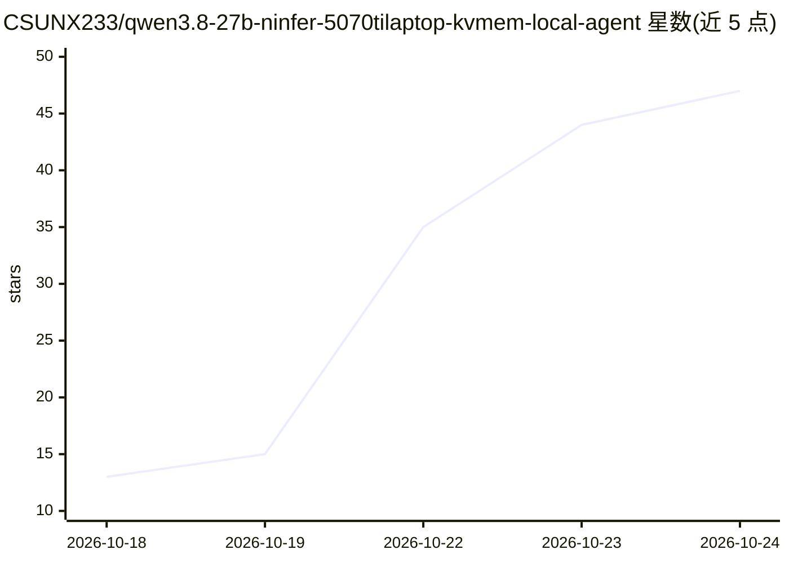

# CSUNX233/qwen3.8-27b-ninfer-5070tilaptop-kvmem-local-agent

⭐ 53 · C++ · Apache-2.0 · 推送 2026-10-24 · [GitHub](https://github.com/CSUNX233/qwen3.8-27b-ninfer-5070tilaptop-kvmem-local-agent) · 个人维护 · 中文 README

**在 12GB 消费级显卡上运行 27B 本地 Agent 的推理部署方案**

面向消费级显卡用户的本地 LLM Agent 部署包：NInfer 引擎运行 Qwen3.8-27B 量化模型，KVMem 将历史 KV 缓存保存在 RAM 按需调入 GPU，配合 MTP 推测解码、缓存守卫与可选 dsh 网页界面，逻辑上下文配置为 256K，支持代码、文件与网页工具任务。提供 Windows 整合包（含引擎、Node、运行库与中文安装文档）与 GitHub 源码安装两种方式。README 明确标注限制：256K 未做完整验收、本版为增量构建、测速为历史记录。模型权重中的 Huihui Swift 衍生部分适用含商业收入门槛的独立许可。

## 筛选速览

| 维度 | 判定 | 备注 |
|---|---|---|
| AI 角色 | `ai-native` | 本体是模型或模型工具 |
| 许可风险 | `permissive` | Apache-2.0 |
| 部署形态 | `None` |  |
| 模型依赖 | — | README 未给出锁定关系 |
| 硬件要求 | — | 无带数字的原话,不猜 |
| 安装摩擦 | `medium` | 含编译或系统依赖之一 |
| 成熟度 | `idea` | |

## 能力要点

- 12GB 显卡运行 27B 量化模型，KVMem 将 KV 缓存驻留 RAM 按需调入 GPU
- MTP3 推测解码与缓存锚点机制减少长任务续接的重复预填充
- 提供 Windows 整合包与源码安装两种部署方式，附中文安装/纠错文档
- 可选 CPU 视觉模式（Huihui 文字+视觉制品）与 dsh 网页界面

## 适用场景

- 在 12GB 显存笔记本上跑 27B 本地模型完成代码、文件与网页工具任务
- 长上下文任务中利用缓存续接减少重复预填充等待
- 本地部署带 OpenAI 兼容接口（1234 端口）的推理服务

## 场景标签

`推理引擎` · 领域:训练与推理

## 证据(README 行号)

> L3: 在消费级显卡上运行 **Qwen3.8-27B 本地 Agent**，支持代码、文件与网页工具任务。NInfer 负责模型推理，KVMem 把历史 KV 保存在 RAM、按需调入 GPU，配合 MTP 推测解码、缓存守卫和可选 ds
> L7: 实测机器：**RTX 5070 Ti Laptop 12GB / i7-14650HX / 32GB RAM / Windows**；模型为 Qwen3.8-27B GSQ-RCO IQ3_XXS + MTP3。下表保留旧版 RK4
> L81: 默认接口：引擎 `http://127.0.0.1:1234/v1`，缓存守卫 `http://127.0.0.1:1236/v1`，dsh 网页 `http://127.0.0.1:3080`。登录凭据只保存在本机日志，不要公开

## 星数曲线

2026-10-18 13 → 2026-10-24 47（+34）

---
*卡片 v1 · prompt 1.4 · 生成 2026-10-24 · 置信度 high · 依据 README sha `68b09fba7600` · [字段定义](../../DATASET.md)*
