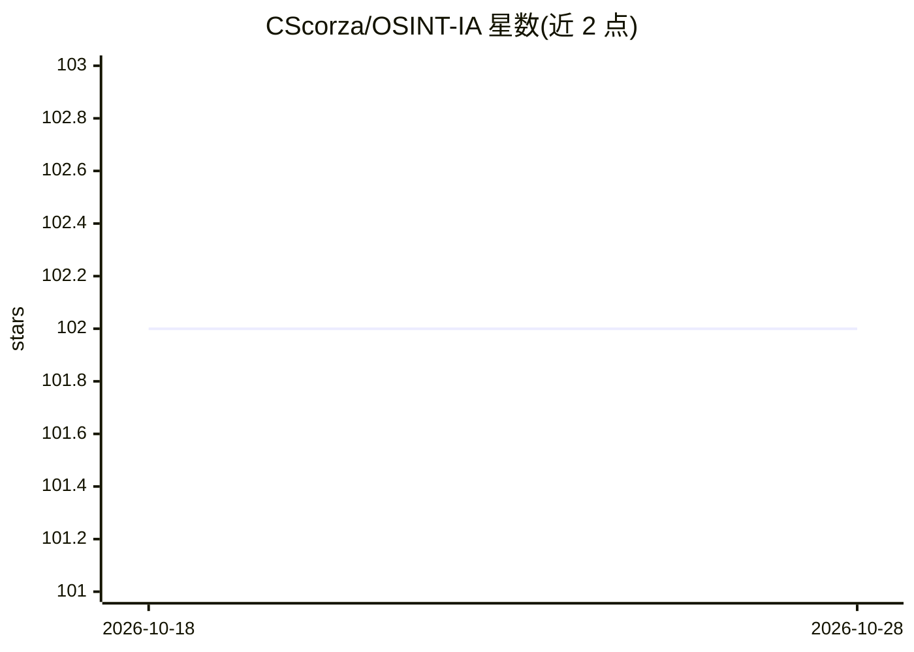

# CScorza/OSINT-IA

⭐ 102 · 推送 2026-09-09 · [GitHub](https://github.com/CScorza/OSINT-IA) · [官网](https://cscorza.github.io/CScorza/) · 个人维护

**面向 OSINT 分析师的 AI 工具策展清单**

意大利语/英语双语维护的 AI 工具清单，面向 OSINT（开源情报）分析师，按用途分类罗列工具：WhatsApp 内 AI 聊天机器人、通用聊天机器人、写作、编程支持、研究检索、Twitter 运营、生产力、内容创作、简历制作、音频转录、YouTube 转录等。条目多为名称列举，个别条目附带简介（如 Dark-Moon 渗透测试平台）。仓库本身不提供可安装运行的软件，仅为链接式目录。

## 筛选速览

| 维度 | 判定 | 备注 |
|---|---|---|
| AI 角色 | `ai-knowledge` | 知识聚合/清单类 |
| 许可风险 | `none` | — |
| 部署形态 | `None` |  |
| 模型依赖 | — | README 未给出锁定关系 |
| 硬件要求 | — | 无带数字的原话,不猜 |
| 安装摩擦 | `low` | 无编译、无系统依赖或容器化 |
| 成熟度 | — | 结构信号不足 |

## 能力要点

- 按 OSINT 分析师工作场景分类的工具清单（写作/转录/编程/研究等十余类）
- 收录 WhatsApp 内可用的 AI 聊天机器人列表
- 个别条目附带简介（如 Dark-Moon 自托管 AI 渗透测试平台）

## 适用场景

- OSINT 分析师按任务类型查找可用的 AI 辅助工具
- 了解面向情报分析各环节（报告撰写、音频转录、视频分析）的 AI 工具分布

## 场景标签

`精选清单` · 领域:学习与行业

## 证据(README 行号)

> L8: Gli strumenti di I.A. sono ottimi supporto per l'attività dell'Analista OSINT.
> L20: Below is a list of useful tools for various activities.

## 星数曲线

2026-10-18 102 → 2026-10-28 102（+0）

---
*卡片 v1 · prompt 1.4 · 生成 2026-10-23 · 置信度 high · 依据 README sha `e8239f7dab31` · [字段定义](../../DATASET.md)*
