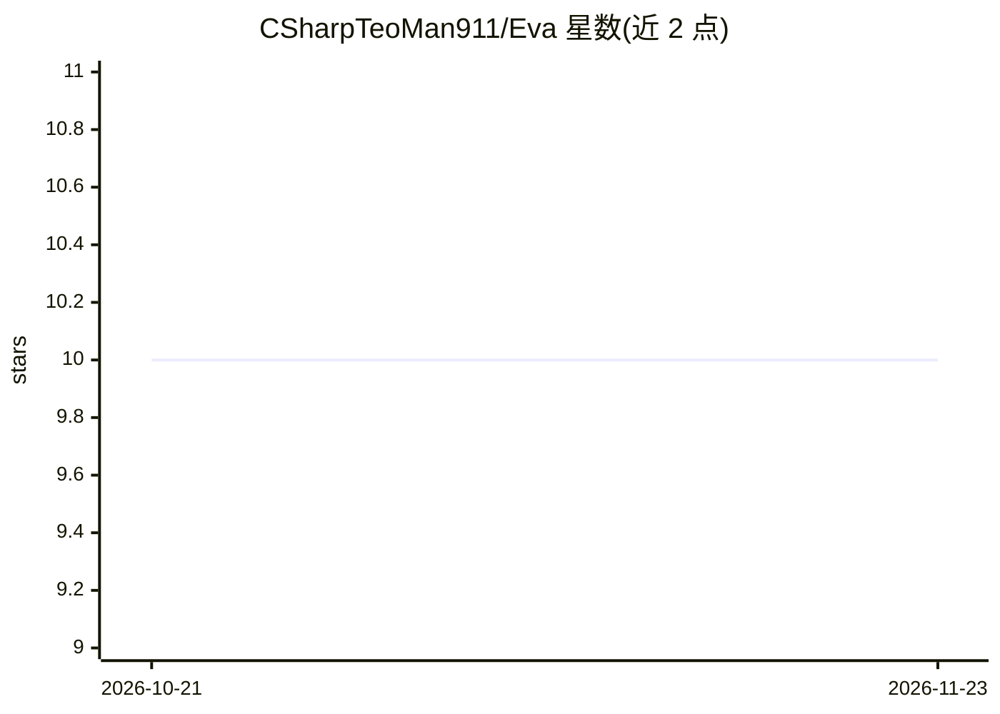

# CSharpTeoMan911/Eva

⭐ 10 · C# · CC0-1.0 · 推送 2026-11-08 · [GitHub](https://github.com/CSharpTeoMan911/Eva) · 个人维护

**面向多任务与残障用户的 Windows 语音 AI 助手**

运行在 Windows（.NET/WPF）上的语音助手：Vosk 常驻监听唤醒词，触发 Granite-Speech 设备端语音识别，再经自研的多轮 tokenization 引擎解析命令并执行动作。功能包括向 ChatGPT 转发语音请求、定时器、截图、打开/关闭应用，以及在 Google、Wikipedia、eBay、Netflix 等十余个网站检索。定位为帮助多任务处理及身心障碍用户的无障碍工具，命令可自定义，提供 MSI 安装包。

## 筛选速览

| 维度 | 判定 | 备注 |
|---|---|---|
| AI 角色 | `ai-native` | 本体是模型或模型工具 |
| 许可风险 | `viral` | CC0-1.0 |
| 部署形态 | `desktop` | 安装包/桌面程序 |
| 模型依赖 | — | README 未给出锁定关系 |
| 硬件要求 | — | 无带数字的原话,不猜 |
| 安装摩擦 | `low` | 无编译、无系统依赖或容器化 |
| 成熟度 | — | 结构信号不足 |

## 能力要点

- Vosk 常驻唤醒 + Granite-Speech 设备端识别的两级语音架构
- Energy-based RMS 语音检测与 Piper 设备端语音合成
- 多轮 tokenization 命令解析引擎，支持自定义命令
- 覆盖十余个网站的语音搜索与系统/应用控制

## 适用场景

- 通过语音完成网页检索、开应用、设定时等日常操作
- 为行动不便用户以语音方式控制电脑
- 语音向 ChatGPT 提问并获取回复

## 场景标签

`AI 助手` `语音 Agent` · 领域:对话与助手

## 证据(README 行号)

> L23: * Eva is an A.I. assistant that has the purpose of helping users multi-task. It also has the use of helping people 
> L28: * The Eva's core technologies are the **Vosk** in-proc speech recognition engine, the **Granite-Speech** in-proc sp
> L42: * The Vosk speech recogniser is listening permanently, if the listening function is activated. Once it recognises t

## 星数曲线

2026-10-21 10 → 2026-11-23 10（+0）

---
*卡片 v1 · prompt 1.4 · 生成 2026-11-20 · 置信度 high · 依据 README sha `17d427234d61` · [字段定义](../../DATASET.md)*
