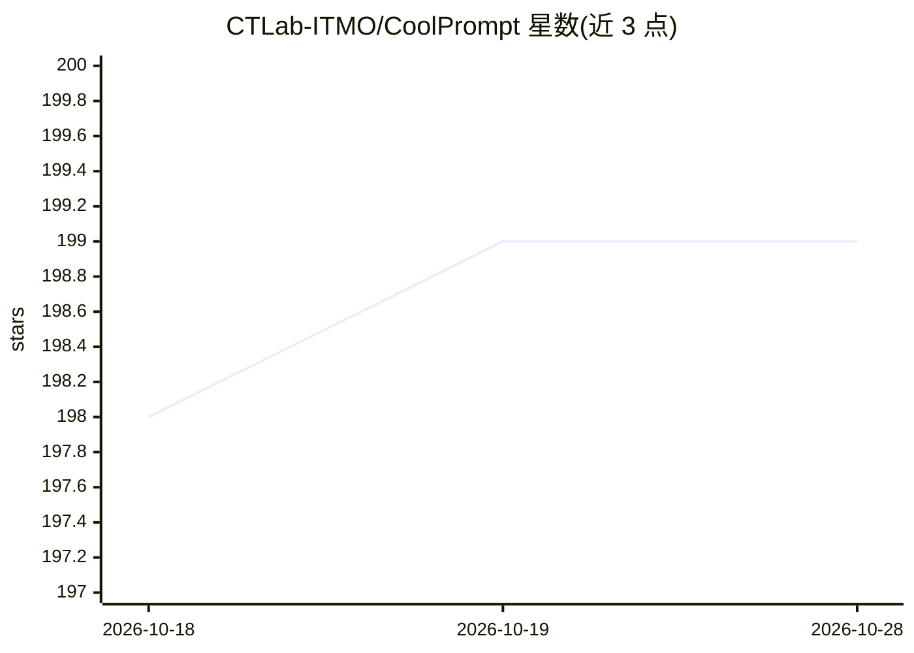

# CTLab-ITMO/CoolPrompt

⭐ 199 · Python · Apache-2.0 · 推送 2026-10-21 · [GitHub](https://github.com/CTLab-ITMO/CoolPrompt) · 组织维护

**自动提示词创建与优化的框架，供 LLM 开发者调优 prompt**

ITMO 大学 CT-Lab 开发的自动提示优化（APO）框架：提供 HyPER、RE-GPS、RIDER、BRAVE、SAPO、PromptCompressor 等多种优化方法，并支持 method="auto" 基于实验元数据自动选择优化器。模型接入通过 LangChain 支持的 LLM（开源到专有均可），默认 OpenAI gpt-4o-mini。附带合成评估数据生成、多指标质量评估与按 token/调用次数的成本核算。以 pip 安装的 Python 库形式提供，多项方法配有发表论文；ReflectivePrompt 与 DistillPrompt 已标记为 legacy/deprecated。

## 筛选速览

| 维度 | 判定 | 备注 |
|---|---|---|
| AI 角色 | `ai-ecosystem` | LLM/agent 周边工具 |
| 许可风险 | `permissive` | Apache-2.0 |
| 部署形态 | `library` | 以包/库形式分发 |
| 模型依赖 | — | README 未给出锁定关系 |
| 硬件要求 | — | 无带数字的原话,不猜 |
| 安装摩擦 | `low` | 无编译、无系统依赖或容器化 |
| 成熟度 | — | 结构信号不足 |

## 能力要点

- 7 种 APO 方法（HyPER/RE-GPS/RIDER/BRAVE/SAPO/PromptCompressor 等）
- 基于实验元数据的自动方法选择（method="auto"）
- LLM 无关：支持任意 LangChain 兼容 LLM（开源到专有）
- 合成评估数据生成、多指标质量评估与成本核算

## 适用场景

- 自动优化分类或生成任务的提示词
- 无输入数据集时生成合成评估数据再优化
- 比较各 APO 方法在数据/耗时/质量/成本上的取舍
- 为微调任务半自动生成标注数据

## 场景标签

`提示工程` · 领域:Agent 开发

## 证据(README 行号)

> L12: CoolPrompt is a framework for automatic prompt creation and optimization.
> L34: - **LLM-Agnostic Choice:** work with your custom llm (from open-sourced to proprietary) using supported Langchain L
> L36: - **Generate synthetic evaluation data** when no input dataset is provided

## 星数曲线

2026-10-18 198 → 2026-10-28 199（+1）

---
*卡片 v1 · prompt 1.4 · 生成 2026-10-22 · 置信度 high · 依据 README sha `a7ab3bb3b8dd` · [字段定义](../../DATASET.md)*
