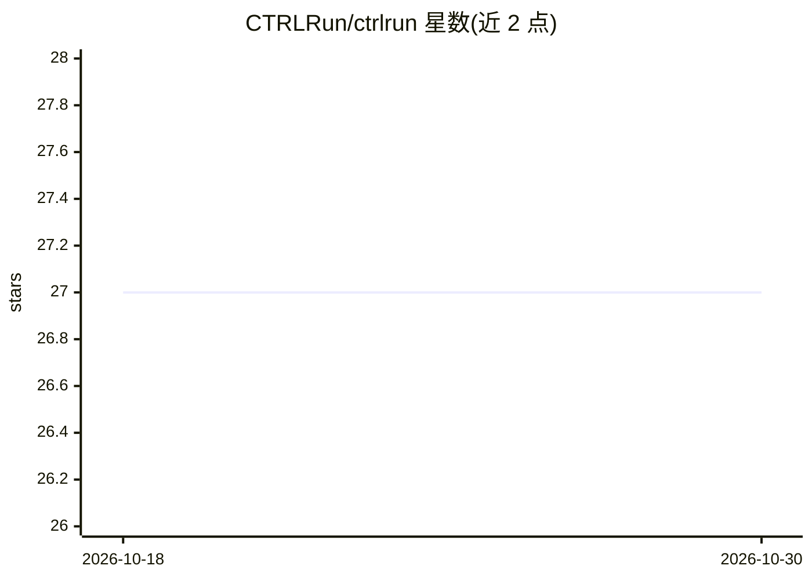

# CTRLRun/ctrlrun

⭐ 27 · Python · Apache-2.0 · 推送 2026-10-29 · [GitHub](https://github.com/CTRLRun/ctrlrun) · [官网](https://ctrlrun.dev/docs) · 组织维护

**AI 代理动作的执行安全层：行动前按规则校验、审批、留痕**

Python 库，嵌入在代理决定与实际调用之间：读取即将发出的调用参数，按 ctrlrun.yaml 策略判定放行、转人工审批或阻断。四条规则：参数变更需重新审批、同一效果键只执行一次、结果未知（AMBIGUOUS）时拒绝重试、每次请求含拒绝都留下链式 JSON 收据。提供 @protect 装饰器（进程内 Python）、MCP 网关（任一语言的工具服务）、LangChain 官方中间件与 LangGraph / OpenAI Agents 适配器。支持单文件或 Postgres 跨主机运行，含预算与授权两轴控制。明确声明不检测提示注入、不回滚。给运行有实际后果动作（支付/删除/部署等）的代理系统的开发者使用。

## 筛选速览

| 维度 | 判定 | 备注 |
|---|---|---|
| AI 角色 | `ai-ecosystem` | LLM/agent 周边工具 |
| 许可风险 | `permissive` | Apache-2.0 |
| 部署形态 | `library` | 以包/库形式分发 |
| 模型依赖 | — | README 未给出锁定关系 |
| 硬件要求 | — | 无带数字的原话,不猜 |
| 安装摩擦 | `low` | 无编译、无系统依赖或容器化 |
| 成熟度 | — | 结构信号不足 |

## 能力要点

- normalize→decide→approve→reserve→execute→resolve→record 七步流水线，含 AMBIGUOUS/FAILED 区分与原子效果键预留
- 审批绑定动作 SHA-256，单次使用且过期，参数变更即失效
- @protect 装饰器、MCP 网关、LangChain 中间件三种接入方式，无需改动代理代码即可覆盖不可修改的代理
- 授权授权可携带滚动窗口预算，AMBIGUOUS 效果冻结预算直至 resolve

## 适用场景

- 给能支付、退款、删除、部署的代理加动作级审批与阻断
- 在 MCP 工具服务前统一做策略校验，不改动代理或服务代码
- 区分调用超时是失败还是结果未知，防止重复扣款类事故
- 为代理动作保留可审计的链式收据

## 场景标签

 · 领域:AI 代理安全/LLM 基础设施

## 证据(README 行号)

> L3:  ctrlrun stops AI agents from taking wrong, restricted, or malicious actions in your workflows.
> L7:  Execution safety for AI agents. A Python library that sits between the decision to act and the call that acts.
> L178: |Tools behind an MCP server, in any language|the gateway: `pip install "ctrlrun[gateway]"`|one command, no change 

## 星数曲线

2026-10-18 27 → 2026-10-30 27（+0）

---
*卡片 v1 · prompt 1.4 · 生成 2026-10-26 · 置信度 high · 依据 README sha `4512946bd45b` · [字段定义](../../DATASET.md)*
