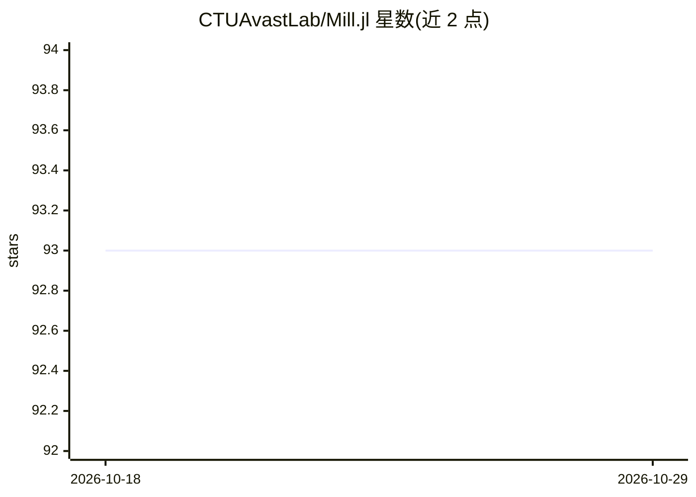

# CTUAvastLab/Mill.jl

⭐ 93 · Julia · MIT · 推送 2026-08-31 · [GitHub](https://github.com/CTUAvastLab/Mill.jl) · [官网](https://ctuavastlab.github.io/Mill.jl/stable/) · 组织维护

**Julia 多示例学习（MIL）库：构建层次化 MIL 模型**

Mill.jl（Multiple Instance Learning Library）是基于 Flux.jl 的 Julia 机器学习库，用于构建灵活的层次化多示例学习模型。设计目标为灵活、通用、快速，且仅依赖少量其他包。提供文档、API 参考与示例；通过 Julia REPL 以 ] add Mill 安装，要求 Julia v1.10 或更高版本。README 引用 JsonGrinder.jl 论文（JMLR，用于任意 JSON 数据的自动可微神经架构嵌入）及一篇使用 Mill.jl 的恶意互联网实体检测论文（IEEE TIFS）。

## 筛选速览

| 维度 | 判定 | 备注 |
|---|---|---|
| AI 角色 | `ai-native` | 本体是模型或模型工具 |
| 许可风险 | `permissive` | MIT |
| 部署形态 | `None` |  |
| 模型依赖 | — | README 未给出锁定关系 |
| 硬件要求 | — | 无带数字的原话,不猜 |
| 安装摩擦 | `low` | 无编译、无系统依赖或容器化 |
| 成熟度 | — | 结构信号不足 |

## 能力要点

- 基于 Flux.jl 构建层次化多示例学习模型
- 处理任意层级结构（树状/bagged）数据的模型构建
- 依赖少量其他包
- 配套 JsonGrinder.jl 生态用于 JSON 数据嵌入

## 适用场景

- 在 Julia 中训练多示例学习模型处理层次化结构数据
- 将任意 JSON 数据自动嵌入后用于神经网络训练
- 科研工作中复现或引用 MIL 相关论文方法

## 场景标签

 · 领域:机器学习/多示例学习

## 证据(README 行号)

> L9: `Mill.jl` (Multiple Instance Learning Library) is a library aimed to build flexible hierarchical multi-instance lear
> L26: Julia v1.10 or later is required.

## 星数曲线

2026-10-18 93 → 2026-10-29 93（+0）

---
*卡片 v1 · prompt 1.4 · 生成 2026-10-23 · 置信度 high · 依据 README sha `9e6f119186d2` · [字段定义](../../DATASET.md)*
