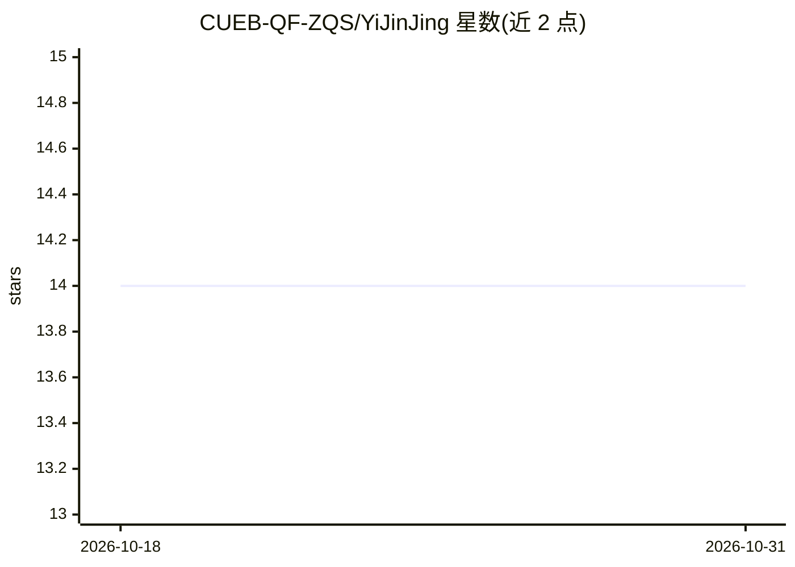

# CUEB-QF-ZQS/YiJinJing

⭐ 14 · Jupyter Notebook · Apache-2.0 · 推送 2025-12-06 · [GitHub](https://github.com/CUEB-QF-ZQS/YiJinJing) · 组织维护 · 中文 README

**LLM+知识图谱+图神经网络的智能投资金融服务方案**

面向金融场景的完整解决方案，含三个模块：FinEX 金融知识抽取智能体（基于通义千问 Tongyi-Finance 14B 做 LoRA 监督微调，从新闻公告中抽取金融事件并生成结构化三元组）；时序多模态知识图谱（融合文本、行情与财务数据构建异构图数据底座）；MEHGT 边增强异构图神经网络（预测个股涨跌/风险并回测）。给量化研究与金融科技开发者使用；FinEX 微调建议使用 A100/H100 级 GPU，训练脚本基于 LLaMA Factory 框架二次开发。

## 筛选速览

| 维度 | 判定 | 备注 |
|---|---|---|
| AI 角色 | `ai-native` | 本体是模型或模型工具 |
| 许可风险 | `permissive` | Apache-2.0 |
| 部署形态 | `library` | 以包/库形式分发 |
| 模型依赖 | — | README 未给出锁定关系 |
| 硬件要求 | — | 无带数字的原话,不猜 |
| 安装摩擦 | `medium` | 含编译或系统依赖之一 |
| 成熟度 | — | 结构信号不足 |

## 能力要点

- FinEX 智能体：Tongyi-Finance 14B + LoRA 微调做金融事件抽取与结构化元组生成
- 时序多模态异构图谱融合文本、行情与财务多源信息
- MEHGT 异构图 Transformer 输出涨跌/风险预测并支持回测（净值曲线、夏普、回撤等）
- 提供 SFT/权重合并/量化/Web Demo 的完整训练脚本

## 适用场景

- 从财经新闻与公告中自动抽取金融事件并构建知识图谱
- 基于图神经网络生成个股趋势预测与交易信号
- 金融量化研究与回测实验

## 场景标签

`知识图谱` `金融量化` · 领域:知识与检索

## 证据(README 行号)

> L13: 易金经基于生成式人工智能、知识图谱和图机器学习等技术体系，打造LLM驱动下融合知识底座和智能投资的金融服务解决方案。方案通过设计FinEX金融知识抽取智能体，实现对新闻公告、资讯舆情的金融文本分析、金融事件抽取和结构化金融知识生成
> L64: FinEX（小金豆）是面向金融领域设计的知识抽取与结构化表示智能体。其基于通义千问大模型进行Lora监督微调微调，通过高质量金融标注语料与任务定制式指令，从财经新闻、公告、研报等非结构化文本中自动识别关键信息（如金融事件、金融实体
> L151: MEHGT（Multimodal Edge-enhanced Heterogeneous Graph Transformer）边增强的多模态异构图神经网络模型。其核心思想是：

## 星数曲线

2026-10-18 14 → 2026-10-31 14（+0）

---
*卡片 v1 · prompt 1.4 · 生成 2026-10-31 · 置信度 high · 依据 README sha `e15f5ba793f5` · [字段定义](../../DATASET.md)*
