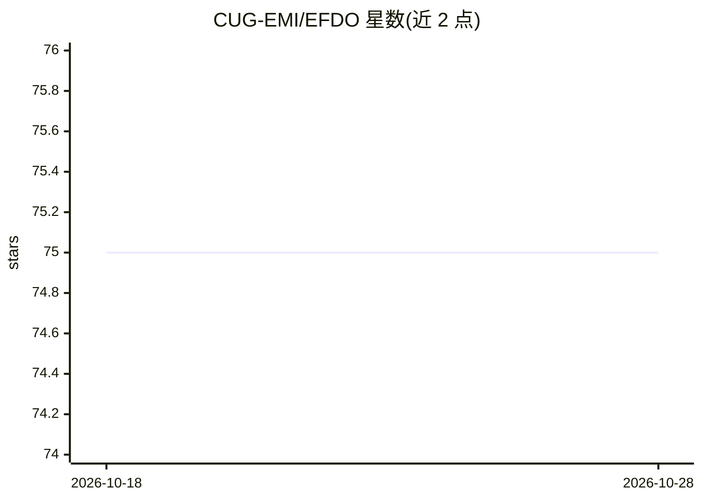

# CUG-EMI/EFDO

⭐ 75 · Jupyter Notebook · Apache-2.0 · 推送 2026-01-06 · [GitHub](https://github.com/CUG-EMI/EFDO) · 组织维护

**大地电磁快速正演的神经网络算子，面向地球物理科研**

EFDO 是扩展 Fourier DeepONet 神经算子网络，用于复杂连续介质中大地电磁（MT）数据的快速正演建模：输入电导率模型，输出预测的正演响应，可下载预训练模型在 Jupyter notebook 中直接预测。工作流覆盖数据集生成（Python 并行脚本或 Julia 高斯随机场，MT 响应需另行用外部正演代码计算）、配置文件驱动的训练、以及基于 GMT/PyGMT/Julia GMT 的论文图表复现脚本。需要 NVIDIA GPU（显存最低 16GB），论文发表于 GEOPHYSICS 2025。

## 筛选速览

| 维度 | 判定 | 备注 |
|---|---|---|
| AI 角色 | `ai-native` | 本体是模型或模型工具 |
| 许可风险 | `permissive` | Apache-2.0 |
| 部署形态 | `library` | 以包/库形式分发 |
| 模型依赖 | — | README 未给出锁定关系 |
| 硬件要求 | `gpu-8g` | |
| 安装摩擦 | `medium` | 含编译或系统依赖之一 |
| 成熟度 | — | 结构信号不足 |

## 能力要点

- 扩展 Fourier DeepONet 架构用于 MT 数据快速正演
- 提供预生成数据集与预训练模型（Google Drive 下载）
- 数据生成、训练、可视化三段式工作流
- GMT/PyGMT/Julia 三种格式的论文绘图脚本

## 适用场景

- 复现论文中的 MT 正演建模结果
- 用预训练模型预测大地电磁正演响应
- 生成高斯随机场电导率模型训练数据集

## 场景标签

`科研工具` `模型训练` · 领域:学习与行业

## 证据(README 行号)

> L9:    title={Fast forward modeling of magnetotelluric data in complex continuous media using an extended Fourier DeepON
> L20: EFDO is a cutting-edge neural operator network designed specifically for geophysical modeling tasks. It combines th

## 星数曲线

2026-10-18 75 → 2026-10-28 75（+0）

---
*卡片 v1 · prompt 1.4 · 生成 2026-10-24 · 置信度 mid · 依据 README sha `846da863478a` · [字段定义](../../DATASET.md)*
