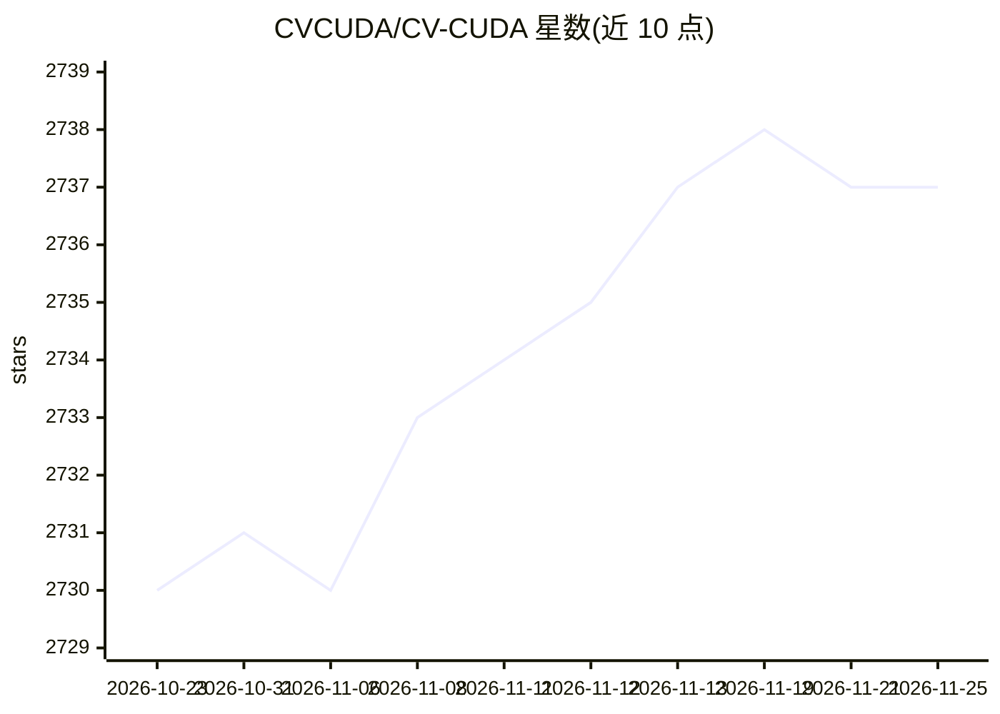

# CVCUDA/CV-CUDA

⭐ 2,737 · C++ · NOASSERTION · 推送 2026-10-20 · [GitHub](https://github.com/CVCUDA/CV-CUDA) · [官网](https://cvcuda.github.io) · 组织维护 · 中文 README

**面向 AI 流水线的 GPU 加速图像/视频处理库**

NVIDIA 与字节跳动合作开源的 GPU 加速计算机视觉算法库，为云端、桌面与边缘平台的 AI 流水线提供高吞吐、低延迟的图像/视频处理算子（如 GPU 加速的图像缩放，示例中与 nvImageCodec 配合）。提供 C/C++ 与 Python 接口，可接入主流图像与 AI 框架。发布形式包括 PyPI wheels（分 CUDA 12/13）、Debian 包、tar 归档及源码构建；不支持原生 Windows（仅 WSL2），v0.16 起弃用 CUDA 11、SM7、Ubuntu 20.04 与 Python 3.8。

## 筛选速览

| 维度 | 判定 | 备注 |
|---|---|---|
| AI 角色 | `ai-native` | 本体是模型或模型工具 |
| 许可风险 | `none` | NOASSERTION |
| 部署形态 | `library` | 以包/库形式分发 |
| 模型依赖 | — | README 未给出锁定关系 |
| 硬件要求 | — | 无带数字的原话,不猜 |
| 安装摩擦 | `medium` | 含编译或系统依赖之一 |
| 成熟度 | — | 结构信号不足 |

## 能力要点

- GPU 加速的图像/视频处理算子库，支持 C/C++ 与 Python
- Python 3.10–3.14（含 free-threaded 3.14t），Linux x86_64 与 aarch64 SBSA/Jetson
- 提供 wheels、Debian 包、tar 归档与 Docker devel 镜像源码构建路径
- Apache-2.0 许可

## 适用场景

- 为云端 AI 视觉流水线添加 GPU 加速的图像预处理/后处理
- 在 Jetson 边缘设备上部署图像/视频处理算子
- 与 nvImageCodec 等框架配合构建视觉搜索、视频增强应用

## 场景标签

`图像视频处理` · 领域:感知与多模态

## 证据(README 行号)

> L14: CV-CUDA is an open-source library of GPU-accelerated computer vision algorithms designed for speed and scalability.
> L88: CV-CUDA originated as a collaboration between [NVIDIA][NVIDIA Develop] and [ByteDance][ByteDance].

## 星数曲线

2026-10-23 2,730 → 2026-11-25 2,737（+7）

---
*卡片 v1 · prompt 1.4 · 生成 2026-11-23 · 置信度 high · 依据 README sha `4a7c8c8ea9a9` · [字段定义](../../DATASET.md)*
