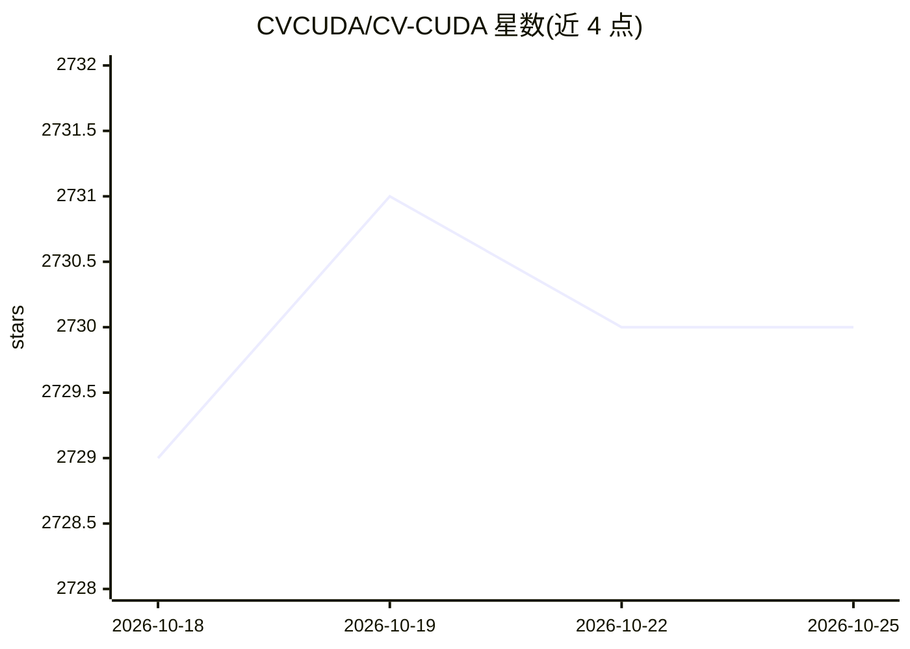

# CVCUDA/CV-CUDA

⭐ 2,730 · C++ · NOASSERTION · 推送 2026-10-20 · [GitHub](https://github.com/CVCUDA/CV-CUDA) · [官网](https://cvcuda.github.io) · 组织维护 · 中文 README

**GPU 加速的计算机视觉算子库：为 AI 流水线做高速图像/视频处理**

由 NVIDIA 与字节跳动合作发起的开源 GPU 加速计算机视觉算子库，以 C++/Python API 提供高吞吐、低延迟的图像与视频处理，面向 NVIDIA 云、桌面与边缘平台上的 AI 流水线。提供预编译 Python wheel（CUDA 12/13）、Debian 包与源码构建三种途径；要求 NVIDIA GPU（≥SM7.5）与对应驱动，不支持原生 Windows（仅 WSL2），同时只能安装一个 CUDA 版本的包。

## 筛选速览

| 维度 | 判定 | 备注 |
|---|---|---|
| AI 角色 | `ai-ecosystem` | LLM/agent 周边工具 |
| 许可风险 | `none` | NOASSERTION |
| 部署形态 | `library` | 以包/库形式分发 |
| 模型依赖 | — | README 未给出锁定关系 |
| 硬件要求 | — | 无带数字的原话,不猜 |
| 安装摩擦 | `medium` | 含编译或系统依赖之一 |
| 成熟度 | — | 结构信号不足 |

## 能力要点

- GPU 加速的图像/视频处理算子，供 C/C++ 与 Python 图像/AI 框架调用
- 预编译 wheel 覆盖 Python 3.10-3.14、x86_64 与 aarch64（含 Jetson）
- 兼容 nvImageCodec 等实现全 GPU 流水线（如 GPU 端图像缩放）
- Apache-2.0 许可，源自 NVIDIA 与 ByteDance 合作

## 适用场景

- 为云端推理服务构建高吞吐图像预处理/后处理流水线
- 在边缘设备（Jetson）上做 GPU 加速视频处理
- 替代 CPU 图像处理路径以降低 AI 视觉流水线延迟

## 场景标签

`图像视频处理` · 领域:感知与多模态

## 证据(README 行号)

> L14: CV-CUDA is an open-source library of GPU-accelerated computer vision algorithms designed for speed and scalability.
> L24: Fully GPU-accelerated image resizing with nvImageCodec and CV-CUDA.
> L88: CV-CUDA originated as a collaboration between [NVIDIA][NVIDIA Develop] and [ByteDance][ByteDance].

## 星数曲线

2026-10-18 2,729 → 2026-10-25 2,730（+1）

---
*卡片 v1 · prompt 1.4 · 生成 2026-10-21 · 置信度 high · 依据 README sha `24579d606c37` · [字段定义](../../DATASET.md)*
