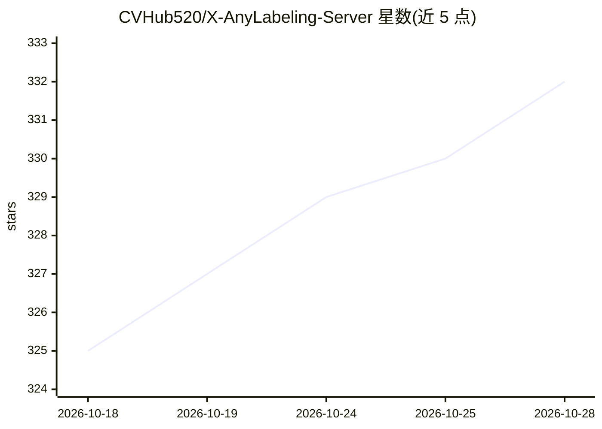

# CVHub520/X-AnyLabeling-Server

⭐ 332 · Python · AGPL-3.0 · 推送 2026-10-18 · [GitHub](https://github.com/CVHub520/X-AnyLabeling-Server) · [官网](https://xanylabeling.com) · 个人维护

**面向 X-AnyLabeling 的 AI 推理服务框架：自动标注后端**

X-AnyLabeling 的服务端框架，负责 AI 模型推理的托管：框架层处理服务管理与资源调度，不介入模型实现细节；提供插件化架构，可在不修改核心代码的情况下接入自定义模型；内置结构化日志、错误处理、并发控制与安全认证，参数均可配置。面向使用 X-AnyLabeling 做图像标注、需要部署自动标注推理后端的开发者，文档覆盖安装配置、自定义模型接入与 API/OpenAPI 说明。

## 筛选速览

| 维度 | 判定 | 备注 |
|---|---|---|
| AI 角色 | `ai-ecosystem` | LLM/agent 周边工具 |
| 许可风险 | `viral` | AGPL-3.0 |
| 部署形态 | `None` |  |
| 模型依赖 | — | README 未给出锁定关系 |
| 硬件要求 | — | 无带数字的原话,不猜 |
| 安装摩擦 | `low` | 无编译、无系统依赖或容器化 |
| 成熟度 | — | 结构信号不足 |

## 能力要点

- 服务管理与模型实现解耦的框架设计
- 插件化架构，无需修改核心代码即可接入自定义模型
- 结构化日志、错误处理、并发控制与安全认证
- 参数可配置，适配不同部署场景

## 适用场景

- 为 X-AnyLabeling 部署自动标注推理后端
- 将自定义视觉模型以服务形式接入标注流程
- 生产环境中托管多种标注模型的推理服务

## 场景标签

`目标检测` `推理引擎` · 领域:感知与多模态

## 证据(README 行号)

> L10: X-AnyLabeling-Server is a simple, lightweight and extensible serving framework for AI model inference, specifically
> L12: - **Decoupled Design**: Framework handles service management and resource scheduling without interfering with model

## 星数曲线

2026-10-18 325 → 2026-10-28 332（+7）

---
*卡片 v1 · prompt 1.4 · 生成 2026-10-21 · 置信度 mid · 依据 README sha `47f0c2130a25` · [字段定义](../../DATASET.md)*
