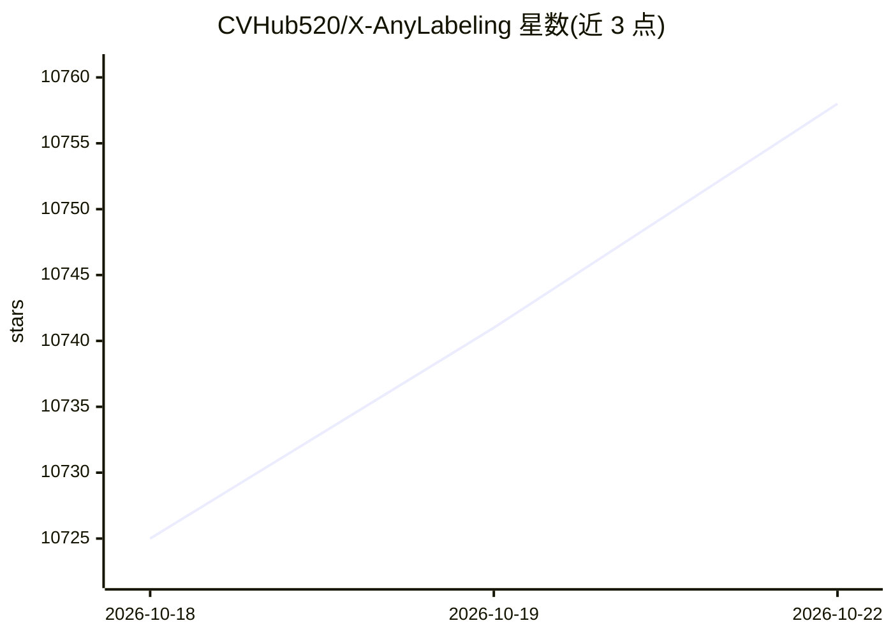

# CVHub520/X-AnyLabeling

⭐ 10,768 · Python · GPL-3.0 · 推送 2026-10-20 · [GitHub](https://github.com/CVHub520/X-AnyLabeling) · [官网](https://xanylabeling.com) · 个人维护 · 中文 README

**AI 辅助数据标注桌面应用：文本/图像/视频/点云/多模态**

跨平台（Windows/Linux/macOS）桌面数据标注应用，支持文本、图像、视频、点云与多模态数据的标注，覆盖分类、检测、分割、姿态估计、跟踪、OCR、文档解析等任务。内置 20 余类模型（YOLO 系列、SAM 系列、Grounding DINO、PP-OCR 等）实现 AI 辅助标注、自动标注与批量数据集预测，支持 ONNX Runtime、TensorRT、OpenCV DNN、vLLM、SGLang 等推理引擎的本地与远程推理，可导入导出 COCO/VOC/YOLO/DOTA 等多种格式。提供 X-AnyLabeling-Server 作为远程推理后端。GPLv3 许可。

## 筛选速览

| 维度 | 判定 | 备注 |
|---|---|---|
| AI 角色 | `ai-ecosystem` | LLM/agent 周边工具 |
| 许可风险 | `viral` | GPL-3.0 |
| 部署形态 | `None` |  |
| 模型依赖 | local-ok | 支持本地模型 |
| 硬件要求 | — | 无带数字的原话,不猜 |
| 安装摩擦 | `low` | 无编译、无系统依赖或容器化 |
| 成熟度 | — | 结构信号不足 |

## 能力要点

- 内置 20 余类任务的模型库（YOLO 系列、SAM 1/2/3、Grounding DINO、PP-OCR 等）
- 支持本地与远程推理（ONNX Runtime、TensorRT、OpenCV DNN、vLLM、SGLang）
- 覆盖图像、视频、点云、文本、多模态数据与 3D 点云标注
- COCO/VOC/YOLO/DOTA/MOT 等多格式导入导出

## 适用场景

- 用预训练模型自动标注目标检测/分割数据集
- 标注 3D 点云的检测与分割数据
- 通过 VLM（Qwen3-VL、Gemini 等）做图像问答与文档解析标注

## 场景标签

 · 领域:计算机视觉/数据标注

## 证据(README 行号)

> L25: **X-AnyLabeling** is a lightweight, efficient, and unified cross-platform desktop application for AI-assisted annot
> L32: * Integrates a wide range of state-of-the-art deep learning models for AI-assisted annotation, automated labeling, 
> L33: * Supports both local and remote inference through engines and serving frameworks such as `ONNX Runtime`, `TensorRT

## 星数曲线

2026-10-18 10,725 → 2026-10-22 10,758（+33）

---
*卡片 v1 · prompt 1.4 · 生成 2026-10-20 · 置信度 high · 依据 README sha `7fb220472558` · [字段定义](../../DATASET.md)*
