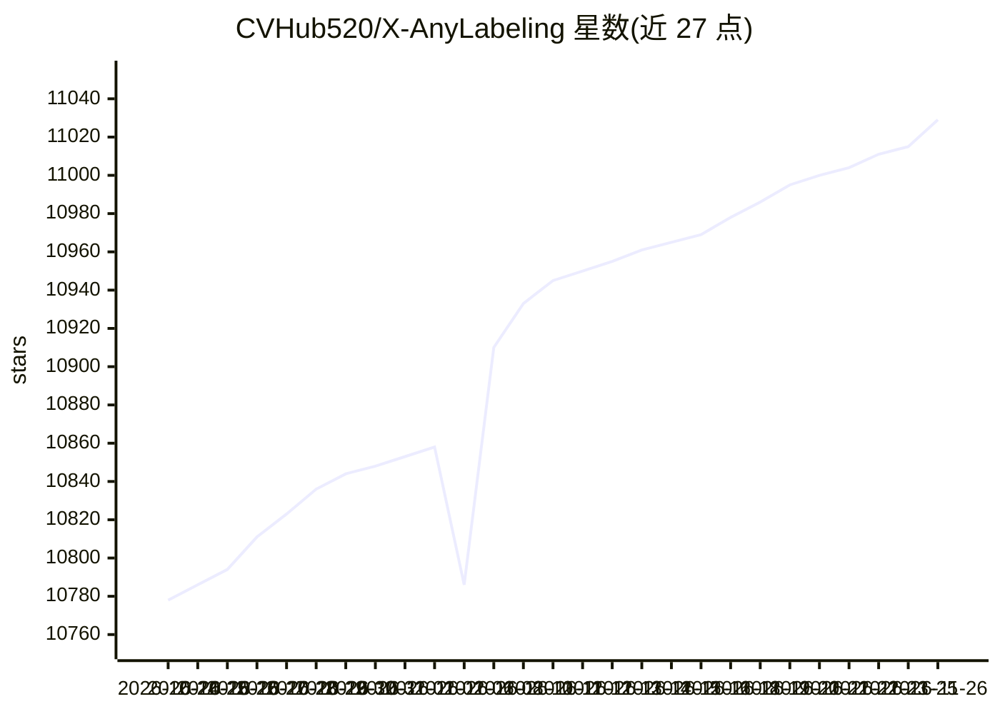

# CVHub520/X-AnyLabeling

⭐ 11,029 · Python · GPL-3.0 · 推送 2026-11-18 · [GitHub](https://github.com/CVHub520/X-AnyLabeling) · [官网](https://xanylabeling.com) · 个人维护 · 中文 README

**跨桌面端 AI 辅助标注工具：标注文本/图像/视频/点云**

X-AnyLabeling 是一个跨平台桌面应用，用于文本、图像、视频、点云及多模态数据的 AI 辅助标注。内置多种标注形状工具，集成模型库对图像分类、检测、分割、姿态估计、OCR、文档解析等任务做自动标注与批量预测；支持 COCO、VOC、YOLO 等多格式导入导出，可接 ONNX Runtime、TensorRT、vLLM 等引擎做本地或远程推理，另提供 X-AnyLabeling-Server 远程推理后端，允许自定义模型集成与二次开发。

## 筛选速览

| 维度 | 判定 | 备注 |
|---|---|---|
| AI 角色 | `ai-native` | 本体是模型或模型工具 |
| 许可风险 | `viral` | GPL-3.0 |
| 部署形态 | `None` |  |
| 模型依赖 | local-ok | 支持本地模型 |
| 硬件要求 | — | 无带数字的原话,不猜 |
| 安装摩擦 | `low` | 无编译、无系统依赖或容器化 |
| 成熟度 | — | 结构信号不足 |

## 能力要点

- 覆盖文本、图像、视频、点云与多模态数据的统一标注
- 集成模型库（YOLO 系列、SAM 系列、Grounding DINO、PP-OCR 等）支持自动标注与批量预测
- 支持 COCO/VOC/YOLO/DOTA/MOT 等多格式导入导出
- 支持 ONNX Runtime、TensorRT、vLLM、SGLang 等本地与远程推理引擎

## 适用场景

- 为检测/分割模型训练制作带标注的数据集
- 用内置模型对数据集做批量预标注后人工修正
- 对 3D 点云做检测与分割标注
- 文档解析与 OCR 标注流水线

## 场景标签

`目标检测` `OCR` `文档解析` · 领域:知识与检索

## 证据(README 行号)

> L35: **X-AnyLabeling** is a lightweight, efficient, and unified cross-platform desktop application for AI-assisted annot
> L42: * Integrates a wide range of state-of-the-art deep learning models for AI-assisted annotation, automated labeling, 

## 星数曲线

2026-10-24 10,778 → 2026-11-26 11,029（+251）

---
*卡片 v1 · prompt 1.4 · 生成 2026-11-22 · 置信度 high · 依据 README sha `b0087d87b077` · [字段定义](../../DATASET.md)*
