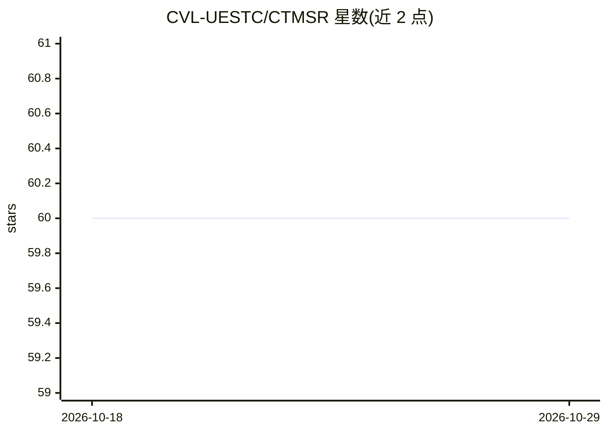

# CVL-UESTC/CTMSR

⭐ 60 · Python · MIT · 推送 2026-01-07 · [GitHub](https://github.com/CVL-UESTC/CTMSR) · [官网](https://arxiv.org/abs/2503.20349) · 组织维护 · 中文 README

**单步生成式超分模型 CTMSR 的官方训练与测试代码**

ICCV 2025 论文 Consistency Trajectory Matching for One-Step Generative Super-Resolution 的官方 PyTorch 代码库，基于一致性模型做扩散轨迹匹配，实现单步图像超分辨率。提供 conda 环境搭建、基于 BasicSR 的多卡分布式训练脚本（ImageNet 数据、4×8 batch）与测试流程（ImageNet-Test/RealSR/RealSet65），并发布预训练模型，代码构建于 BasicSR 与 ResShift 之上。

## 筛选速览

| 维度 | 判定 | 备注 |
|---|---|---|
| AI 角色 | `ai-native` | 本体是模型或模型工具 |
| 许可风险 | `permissive` | MIT |
| 部署形态 | `None` |  |
| 模型依赖 | — | README 未给出锁定关系 |
| 硬件要求 | — | 无带数字的原话,不猜 |
| 安装摩擦 | `low` | 无编译、无系统依赖或容器化 |
| 成熟度 | — | 结构信号不足 |

## 能力要点

- 一致性轨迹匹配实现单步生成式超分辨率
- 提供多卡分布式训练命令与配置文件
- 提供预训练模型与测试数据流程（ImageNet-Test/RealSR/RealSet65）

## 适用场景

- 复现 ICCV 2025 论文的训练与测试结果
- 使用预训练模型对真实图像做超分辨率
- 在一致性模型/扩散超分方向做后续研究

## 场景标签

`图像视频处理` · 领域:感知与多模态

## 证据(README 行号)

> L1: Consistency Trajectory Matching for One-Step Generative Super-Resolution (ICCV 2025)
> L35: CUDA_VISIBLE_DEVICES=0,1,2,3 python -m torch.distributed.launch --use-env --nproc_per_node=4 --master_port=1145  ba

## 星数曲线

2026-10-18 60 → 2026-10-29 60（+0）

---
*卡片 v1 · prompt 1.4 · 生成 2026-10-24 · 置信度 high · 依据 README sha `64a4e40fd411` · [字段定义](../../DATASET.md)*
