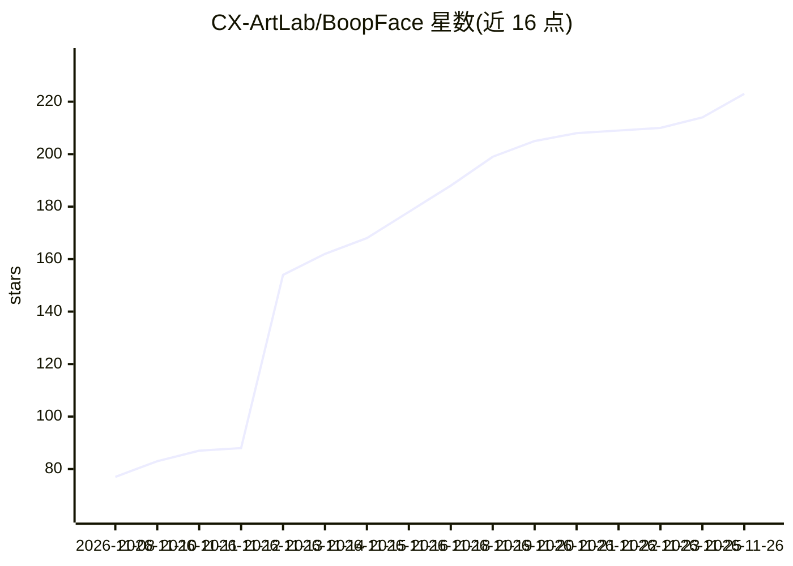

# CX-ArtLab/BoopFace

⭐ 223 · JavaScript · MIT · 推送 2026-11-25 · [GitHub](https://github.com/CX-ArtLab/BoopFace) · [官网](https://boopface.com) · 组织维护 · 中文 README

**给 AI bot/agent 加表情机器人头像的 Web 组件**

以 SVG 和原生 Web Component 实现的机器人表情组件，零运行时依赖，MIT 许可；提供 30+ 表达式动作（等待、成功、失败、倾听、说话等）与可编程的 agent 状态接口，支持 2D/3D 视图、188 款皮肤、指针跟随与拖拽交互；connectAgent() 让 AI 流事件驱动表情（AG-UI、OpenAI、Anthropic、Vercel AI SDK），另有 Voice Kit 语音表情组。通过 npm 或发布压缩包分发，含 lite 构建与 TypeScript 声明；BoopFace Embedded 提供 28 种 ESP32/STM32/Raspberry Pi Pico 板卡屏幕固件示例。

## 筛选速览

| 维度 | 判定 | 备注 |
|---|---|---|
| AI 角色 | `ai-enhanced` | 去掉 AI 部分产品仍成立 |
| 许可风险 | `permissive` | MIT |
| 部署形态 | `desktop` | 安装包/桌面程序 |
| 模型依赖 | locked-api |  |
| 硬件要求 | — | 无带数字的原话,不猜 |
| 安装摩擦 | `low` | 无编译、无系统依赖或容器化 |
| 成熟度 | `idea` | |

## 能力要点

- 原生 Web Component，SVG 渲染，零运行时依赖
- 30+ 表达式动作覆盖 agent 等待/成功/失败等状态
- connectAgent() 以 AI 流事件驱动表情（AG-UI、OpenAI、Anthropic、Vercel AI SDK）
- Embedded 版本支持 28 种 ESP32/STM32/Pico 板卡与屏幕配置

## 适用场景

- 给聊天助手或 coding agent 加表情状态反馈
- 桌面伴侣、虚拟宠物、chatbot 头像等交互角色
- 在 ESP32/Pico 小屏幕上显示机器人眼睛表情
- AG-UI 风格 agent 界面的可视化反馈层

## 场景标签

`聊天机器人` · 领域:对话与助手

## 证据(README 行号)

> L13: BoopFace is a lightweight, expressive robot avatar component for AI bots, agents and interactive apps. Thinking, wa
> L66: - `connectAgent()`: AI stream events drive the expressions (AG-UI, OpenAI, Anthropic, Vercel AI SDK)
> L25:  BoopFace Embedded: the same eye expressions on ESP32, STM32 and Raspberry Pi Pico screens, or in other C++ program

## 星数曲线

2026-11-08 77 → 2026-11-26 223（+146）

---
*卡片 v1 · prompt 1.4 · 生成 2026-11-26 · 置信度 high · 依据 README sha `2870a989eaf5` · [字段定义](../../DATASET.md)*
