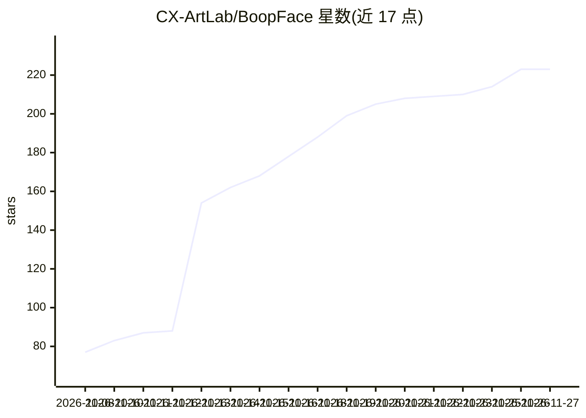

# CX-ArtLab/BoopFace

⭐ 223 · HTML · MIT · 推送 2026-11-26 · [GitHub](https://github.com/CX-ArtLab/BoopFace) · [官网](https://boopface.com) · 个人维护 · 中文 README

**给 AI 机器人与 Agent 显示表情状态的机器人头像 Web 组件**

以 SVG 和原生 JavaScript 构建的 Web Component，零运行时依赖，可在任意框架（React/Vue 等）中使用。组件为 AI 助手与 Agent 提供面部与状态反馈：30+ 表情对应思考、等待、完成、失败等状态，支持 3D 头部与 188 个皮肤。通过 connectAgent() 接入 AG-UI、OpenAI、Anthropic、Vercel AI SDK 等流式事件自动切换表情，语音对话提供听/想/说三态接口。另提供 BoopFace Embedded 将表情运行于 ESP32、STM32、Raspberry Pi Pico 开发板屏幕。MIT 许可。

## 筛选速览

| 维度 | 判定 | 备注 |
|---|---|---|
| AI 角色 | `ai-enhanced` | 去掉 AI 部分产品仍成立 |
| 许可风险 | `permissive` | MIT |
| 部署形态 | `desktop` | 安装包/桌面程序 |
| 模型依赖 | locked-api |  |
| 硬件要求 | — | 无带数字的原话,不猜 |
| 安装摩擦 | `low` | 无编译、无系统依赖或容器化 |
| 成熟度 | — | 结构信号不足 |

## 能力要点

- 30+ 表情覆盖 Agent 全部状态，AI 流事件可直接驱动表情
- connectAgent() 支持 AG-UI、OpenAI、Anthropic Messages、Vercel AI SDK
- 188 个皮肤、3D 头部、眼睛跟随指针等交互
- BoopFace Embedded 在 ESP32/STM32/Raspberry Pi Pico 屏幕运行

## 适用场景

- 给聊天机器人或 Agent 加一个显示思考/等待/完成状态的头像
- 语音助手按听/想/说流程切换表情
- 在开发板屏幕上给嵌入式 AI 设备做表情界面
- 桌面伴侣、虚拟宠物或数字吉祥物的形象

## 场景标签

 · 领域:前端 UI 组件/机器人形象

## 证据(README 行号)

> L13: BoopFace is a lightweight, expressive robot avatar component for AI bots, agents and interactive apps. Thinking, wa
> L57: - Events from AI streams drive the expressions directly (AG-UI, OpenAI, Anthropic, Vercel AI SDK), voice conversati

## 星数曲线

2026-11-08 77 → 2026-11-27 223（+146）

---
*卡片 v1 · prompt 1.4 · 生成 2026-11-27 · 置信度 high · 依据 README sha `dd4afdc032da` · [字段定义](../../DATASET.md)*
