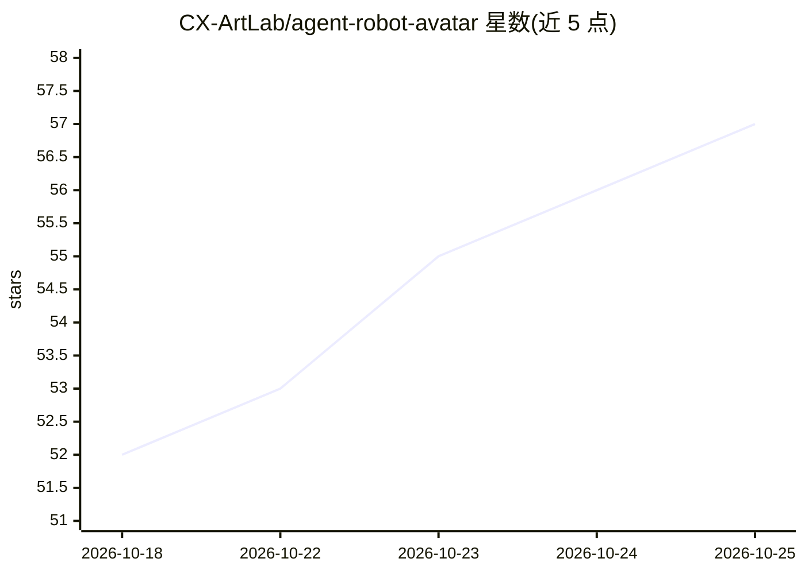

# CX-ArtLab/agent-robot-avatar

⭐ 57 · JavaScript · MIT · 推送 2026-10-24 · [GitHub](https://github.com/CX-ArtLab/agent-robot-avatar) · [官网](https://cx-artlab.github.io/agent-robot-avatar/?lang=en) · 个人维护 · 中文 README

**给 AI agent 界面加可交互动画机器人头像的 Web Component**

零依赖的原生 Web Component，用 SVG 与 vanilla JavaScript 实现机器人头像：提供眨眼、指针跟随眼神、头部惯性、拖拽果冻形变、天线弹簧等交互，以及 waiting/success/failure/blocked 等编程控制的 Agent 状态反馈，并通过 face-state 与 action-state 事件接入宿主界面。面向构建 AI 助手与 agent 界面的开发者，可直接用于聊天机器人、桌面宠物、数字吉祥物等场景。另有实验性的 C++11 嵌入式眼睛引擎，覆盖 ESP32/RP2040 等开发板示例（未经真机验证）。当前公开版本 v0.6.0，API 面向未来 1.0 保持精简。

## 筛选速览

| 维度 | 判定 | 备注 |
|---|---|---|
| AI 角色 | `ai-ecosystem` | LLM/agent 周边工具 |
| 许可风险 | `permissive` | MIT |
| 部署形态 | `library` | 以包/库形式分发 |
| 模型依赖 | — | README 未给出锁定关系 |
| 硬件要求 | — | 无带数字的原话,不猜 |
| 安装摩擦 | `low` | 无编译、无系统依赖或容器化 |
| 成熟度 | `idea` | |

## 能力要点

- 原生 Web Component，零运行时依赖，含 TypeScript 声明
- 18+ 种可编程动作与 Agent 状态（waiting/success/failure/blocked 等）
- face-state / action-state 事件供宿主集成与无障碍状态文本
- 实验性 C++11 嵌入式眼睛引擎，覆盖 26 种 ESP32/RP2040 开发板屏幕配置

## 适用场景

- 为 AI 助手或 agent 界面添加有状态反馈的头像动画
- 做聊天机器人、桌面宠物或数字吉祥物的交互角色
- 在 AG-UI 风格的 agent 界面中作为视觉反馈层
- 在开发板屏幕上运行 eyes-only 表情引擎（实验性）

## 场景标签

 · 领域:前端/UI 组件

## 证据(README 行号)

> L11: A lightweight, expressive robot avatar Web Component for AI agents and interactive applications.
> L17: Agent Robot Avatar can also be used as a visual feedback layer for AG-UI-style agent interfaces.

## 星数曲线

2026-10-18 52 → 2026-10-25 57（+5）

---
*卡片 v1 · prompt 1.4 · 生成 2026-10-24 · 置信度 high · 依据 README sha `36ebd59eb26d` · [字段定义](../../DATASET.md)*
