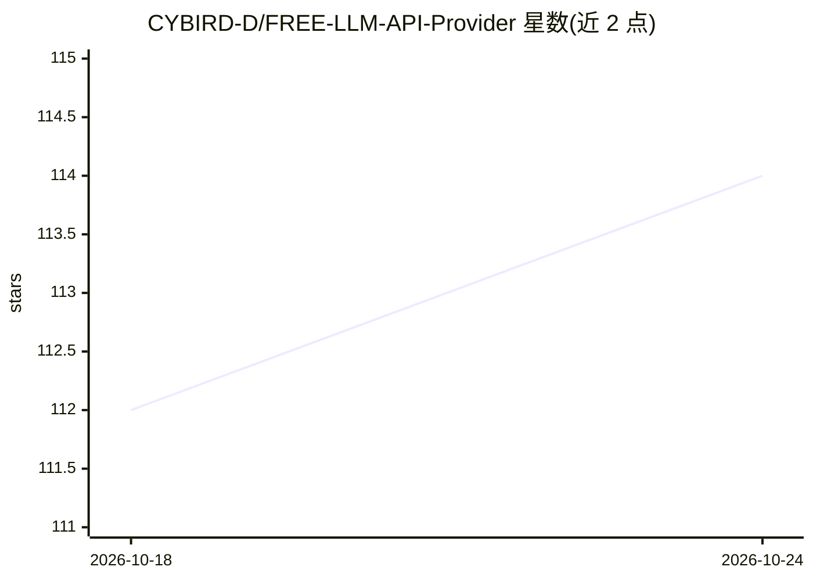

# CYBIRD-D/FREE-LLM-API-Provider

⭐ 115 · 推送 2026-10-23 · [GitHub](https://github.com/CYBIRD-D/FREE-LLM-API-Provider) · 个人维护 · 中文 README

**免费 LLM API 平台清单：汇总各平台免费额度与速率限制**

收录可通过 API 访问的免费 LLM 平台的聚合清单，覆盖 Google/Gemma、NVIDIA NIM、Ollama Cloud、Groq、Cerebras、OpenRouter、Cloudflare 等全球平台及火山引擎、ModelScope 等中国平台。每家条目记录 Endpoint 地址、免费模型列表、RPM/TPM/RPD 速率限制与定价表，并标注核查日期。附接入指南：注册平台、获取 API Key 与 Endpoint 后填入支持该平台的软件。清单不定期更新，部分条目标注已失效（如 Cerebras 免费额度不可用）。

## 筛选速览

| 维度 | 判定 | 备注 |
|---|---|---|
| AI 角色 | `ai-knowledge` | 知识聚合/清单类 |
| 许可风险 | `none` | — |
| 部署形态 | `None` |  |
| 模型依赖 | — | README 未给出锁定关系 |
| 硬件要求 | — | 无带数字的原话,不猜 |
| 安装摩擦 | `low` | 无编译、无系统依赖或容器化 |
| 成熟度 | — | 结构信号不足 |

## 能力要点

- 按平台记录免费模型列表与 RPM/TPM/RPD 速率限制
- 覆盖全球与国内（火山引擎/ModelScope 等）两类平台
- 含 Ollama Cloud 订阅方案与按 token 定价表
- 条目标注最后核查日期，失效内容用删除线标记

## 适用场景

- 寻找免费可用的 LLM API 平台并比较额度限制
- 为翻译等应用挑选速率合适的免费模型
- 了解各平台免费层定价与配额变化

## 场景标签

`精选清单` · 领域:学习与行业

## 证据(README 行号)

> L4: This is a list of free llm providers and their rate usage limits
> L7: 免费LLM api平台（包括cn平台）
> L35: ## Content/目录

## 星数曲线

2026-10-18 112 → 2026-10-24 114（+2）

---
*卡片 v1 · prompt 1.4 · 生成 2026-10-23 · 置信度 high · 依据 README sha `9bf74c6247f0` · [字段定义](../../DATASET.md)*
