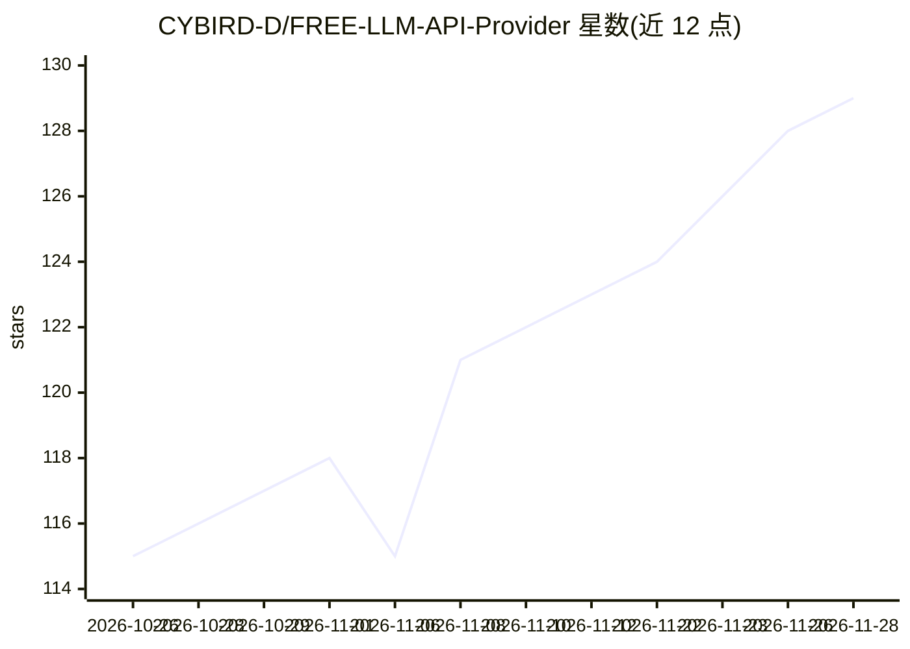

# CYBIRD-D/FREE-LLM-API-Provider

⭐ 129 · 推送 2026-11-17 · [GitHub](https://github.com/CYBIRD-D/FREE-LLM-API-Provider) · 个人维护 · 中文 README

**免费 LLM API 平台汇总目录：整理各平台额度与限流**

以目录形式追踪可通过 API 免费调用的 LLM 推理平台（含中国大陆平台），逐平台记录账号要求、API base URL、免费额度形式（每日刷新额度/一次性试用额度/免月费按量付费）、速率限制与模型目录。条目附 Last checked 日期，标注额度不保证与可变性，并区分三类'免费'概念。纯文档清单，不提供软件安装或运行方式。

## 筛选速览

| 维度 | 判定 | 备注 |
|---|---|---|
| AI 角色 | `ai-knowledge` | 知识聚合/清单类 |
| 许可风险 | `none` | — |
| 部署形态 | `None` |  |
| 模型依赖 | — | README 未给出锁定关系 |
| 硬件要求 | — | 无带数字的原话,不猜 |
| 安装摩擦 | `low` | 无编译、无系统依赖或容器化 |
| 成熟度 | — | 结构信号不足 |

## 能力要点

- 逐平台记录 OpenAI 兼容 endpoint、免费额度与速率限制
- 区分免费调用、一次性试用额度与 $0/月按量付费三类形态
- 收录中国大陆平台（AMD Radeon Cloud Token Factory、ModelScope、Volcengine 等）
- 条目附 Last checked 日期与多语言版本

## 适用场景

- 找免费额度的 LLM API 用于个人项目或原型验证
- 对比各平台速率限制和模型目录后再注册账号
- 查询某平台当前免费层覆盖哪些模型

## 场景标签

`精选清单` · 领域:学习与行业

## 证据(README 行号)

> L6: This directory tracks **free LLM inference APIs**, their account requirements and rate limits (including CN provider
> L11: 免费 LLM API 平台汇总（包括中国大陆平台）。**免费调用、一次性试用额度和按量付费（免月费）应分别判断**。

## 星数曲线

2026-10-26 115 → 2026-11-28 129（+14）

---
*卡片 v1 · prompt 1.4 · 生成 2026-11-28 · 置信度 mid · 依据 README sha `64c349bd3af2` · [字段定义](../../DATASET.md)*
