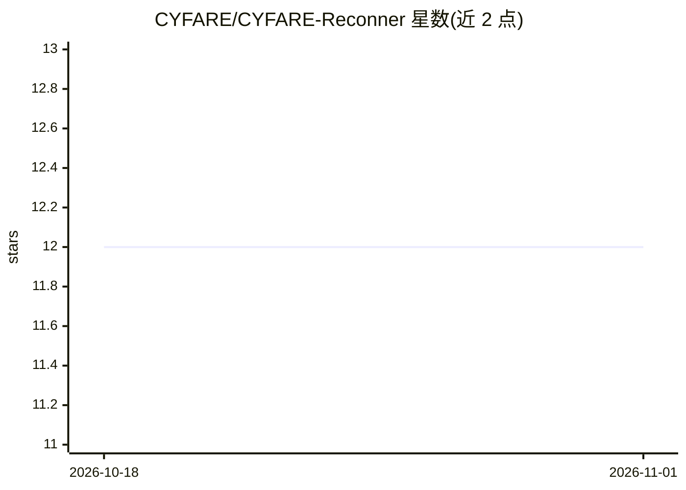

# CYFARE/CYFARE-Reconner

⭐ 12 · JavaScript · GPL-3.0 · 推送 2025-11-14 · [GitHub](https://github.com/CYFARE/CYFARE-Reconner) · [官网](https://cyfare.net/) · 组织维护

**面向安全测试的 Firefox 链接侦察浏览器扩展**

CYFARE-Reconner 是一款 Firefox 浏览器扩展（版本 3），面向安全审计、Bug Bounty、OSINT 与渗透测试人员，用于目标网站的链接侦察：深度发现隐藏端点与目录、分析 JavaScript 中的硬编码密钥与 API 端点、分析 URL 参数、模拟用户交互触发动态内容并捕获 AJAX 响应，扫描结果自动以 JSON 导出并提供分析面板。README 标注 'AI Powered' 但未说明具体模型或机制。通过 Mozilla Add-ons 商店安装，GPL-3.0 许可。

## 筛选速览

| 维度 | 判定 | 备注 |
|---|---|---|
| AI 角色 | `ai-enhanced` | 去掉 AI 部分产品仍成立 |
| 许可风险 | `viral` | GPL-3.0 |
| 部署形态 | `None` |  |
| 模型依赖 | — | README 未给出锁定关系 |
| 硬件要求 | — | 无带数字的原话,不猜 |
| 安装摩擦 | `low` | 无编译、无系统依赖或容器化 |
| 成熟度 | — | 结构信号不足 |

## 能力要点

- 深度链接发现：隐藏端点、目录与站点结构映射
- JavaScript 分析：检测硬编码 API 密钥与 API 端点
- 事件模拟触发动态内容加载并捕获 AJAX 响应
- 扫描结果自动 JSON 导出与分析面板

## 适用场景

- 对目标网站做安全审计，识别暴露端点与敏感数据
- Bug Bounty 中发现隐藏功能与潜在漏洞
- OSINT 情报收集与攻击面测绘

## 场景标签

`网络安全` · 领域:学习与行业

## 证据(README 行号)

> L2:  AI Powered
> L81: |**Security Auditing**|Identify exposed endpoints and sensitive data in web applications|

## 星数曲线

2026-10-18 12 → 2026-11-01 12（+0）

---
*卡片 v1 · prompt 1.4 · 生成 2026-11-01 · 置信度 mid · 依据 README sha `658c1305ca05` · [字段定义](../../DATASET.md)*
