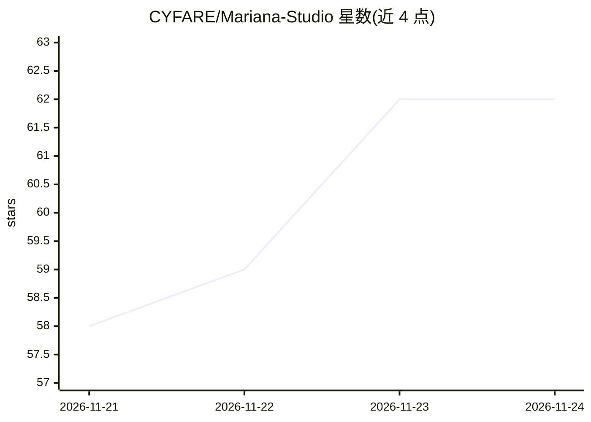

# CYFARE/Mariana-Studio

⭐ 61 · Python · AGPL-3.0 · 推送 2026-11-23 · [GitHub](https://github.com/CYFARE/Mariana-Studio) · [官网](https://cyfare.net/) · 组织维护

**本地一站式语言模型训练/微调/部署工作台**

从单个本地工作区覆盖语言模型研发全流程：从零训练字节级混合扩散-自回归模型、对本地或 Hugging Face 检查点做 LoRA/全量微调、流式聊天、AML/AMP 代理编排与调度、代理式 IDE 编码、评估，并导出 GGUF/ONNX/safetensors。设备自动按 CUDA→Intel XPU→Apple MPS→CPU 选择，面向小显存消费级 GPU。附带四份白皮书与 runbook，仓库不含预训练检查点，需自行训练或下载。

## 筛选速览

| 维度 | 判定 | 备注 |
|---|---|---|
| AI 角色 | `ai-ecosystem` | LLM/agent 周边工具 |
| 许可风险 | `viral` | AGPL-3.0 |
| 部署形态 | `library` | 以包/库形式分发 |
| 模型依赖 | local-ok | 支持本地模型 |
| 硬件要求 | `cpu-ok` | |
| 安装摩擦 | `medium` | 含编译或系统依赖之一 |
| 成熟度 | — | 结构信号不足 |

## 能力要点

- 训练/微调/聊天/代理/IDE/评估/导出集中在一个本地 UI
- 自动设备选择 CUDA→XPU→MPS→CPU，面向 8 GB 消费级 GPU
- 导出 LLaMA 架构 GGUF、Ollama Modelfile、ONNX 与 safetensors
- 每项技术附白皮书、runbook 与实现代码

## 适用场景

- 在小显存 GPU 上从零训练或微调语言模型
- 本地编排代理工作流与定时任务
- 把训练好的模型导出给 llama.cpp/Ollama 等运行时使用
- 在代理式 IDE 中围绕模型代码开展研发

## 场景标签

`模型训练` `微调` `Agent 框架` · 领域:Agent 开发

## 证据(README 行号)

> L19: Mariana is a **one-stop research and development studio for language models**.
> L30: - **One workspace** — data, training, fine-tuning, chat, agents, IDE, evaluation
> L37: - **Portable models** — lossless AR export to GGUF, ONNX and safetensors, ready

## 星数曲线

2026-11-21 58 → 2026-11-24 62（+4）

---
*卡片 v1 · prompt 1.4 · 生成 2026-11-21 · 置信度 high · 依据 README sha `c6d7b6d6cdaa` · [字段定义](../../DATASET.md)*
