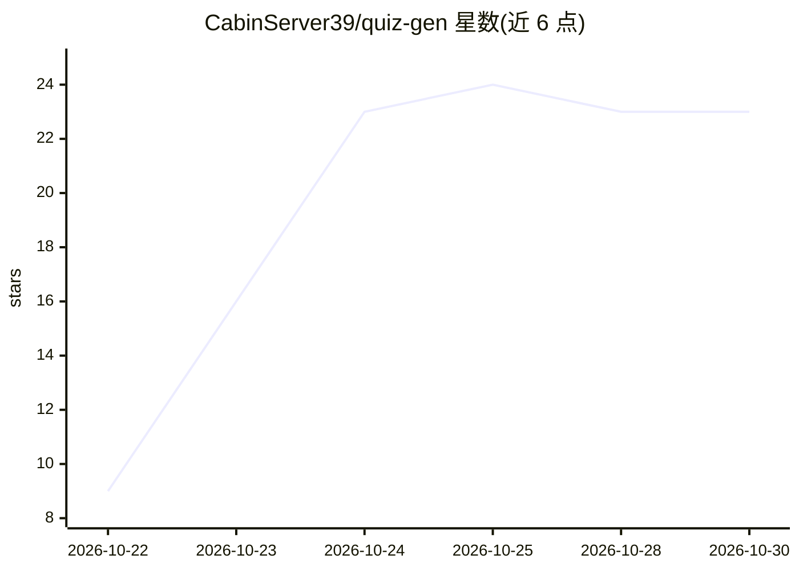

# CabinServer39/quiz-gen

⭐ 23 · C# · MIT · 推送 2026-10-18 · [GitHub](https://github.com/CabinServer39/quiz-gen) · 个人维护

**Windows 本地 LLM 出题工具：从讲义生成可打印试卷与答案**

面向教师/出题者的 Windows 便携应用：读取本地笔记文本，通过内置 llama.cpp 运行的本地模型离线生成四种题型（选择、判断、简答、填空），支持按次调节难度、重测验变体、按来源章节打标签，输出可打印的学生卷与含答案解析的教师卷（HTML/PDF 风格）。100 MB 自包含单文件 exe，无需安装、无遥测，MIT 许可。源码构建需 Windows 10/11 x64 与 .NET 8 SDK。

## 筛选速览

| 维度 | 判定 | 备注 |
|---|---|---|
| AI 角色 | `ai-native` | 本体是模型或模型工具 |
| 许可风险 | `permissive` | MIT |
| 部署形态 | `None` |  |
| 模型依赖 | — | README 未给出锁定关系 |
| 硬件要求 | — | 无带数字的原话,不猜 |
| 安装摩擦 | `medium` | 含编译或系统依赖之一 |
| 成熟度 | — | 结构信号不足 |

## 能力要点

- 四种题型生成，支持难度分级与重测验变体
- 本地 LLM（llama.cpp）离线运行，源文本不出本机
- 同时输出学生卷与含答案解析的教师卷，排版面向打印
- 100 MB 自包含便携 exe，无广告无账号无遥测，CI 发布 SHA-256 校验

## 适用场景

- 把课堂讲义转成可打印的测验卷和答案册
- 同一材料生成不同题目供第二周重测
- 按章节标签挑选题目做针对性复习卷

## 场景标签

`AI 写作` · 领域:内容生成

## 证据(README 行号)

> L3: ❓ Free, open-source quiz generator for Windows — build printable tests with answer keys from notes via local LLM. 10
> L17: - ✅ **100 MB self-contained exe** — runtime bundled, model runs locally via llama.cpp, offline, MIT

## 星数曲线

2026-10-22 9 → 2026-10-30 23（+14）

---
*卡片 v1 · prompt 1.4 · 生成 2026-10-27 · 置信度 high · 依据 README sha `2ae0ef547345` · [字段定义](../../DATASET.md)*
